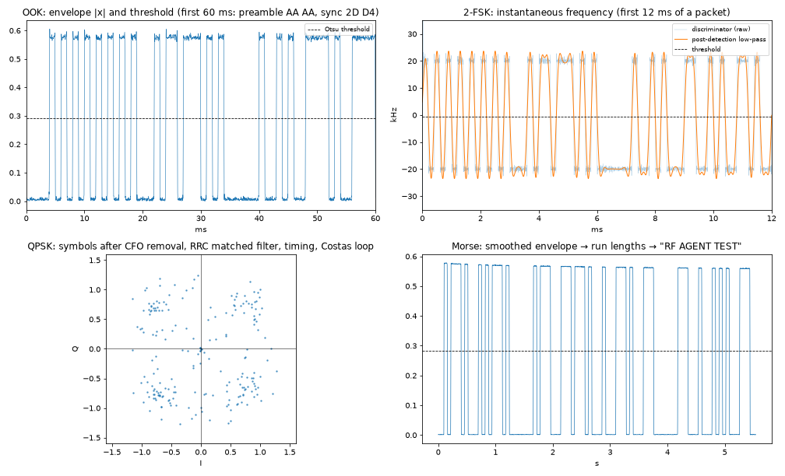

# Demodulation recipes

Concrete, tested receive chains from IQ file to payload. Every recipe here is implemented in
[`tools/rx_decode.py`](../tools/rx_decode.py) and was verified over the air on this bench
(HackRF → RTL-SDR at 433.92 MHz). Each step says what to plot or check so you know the rung is solid.

```python
import numpy as np
from rfkit import iq, dsp, bits, plot
x, fs = iq.load("capture.wav")          # SDR++ WAV; raw files: iq.load("cap.cu8", fs=2.048e6)
x = x[int(0.05 * fs):]                  # drop the receiver's settling transient
plot.overview(x, fs, "overview.png")    # ALWAYS look first
```



*Intermediate signals from the recipes below, computed from over-the-air captures: an OOK envelope with
its Otsu threshold (the `AA AA` preamble then the `2D D4` sync), the 2-FSK discriminator before and after
post-detection filtering, QPSK symbols after carrier/timing recovery (four clusters, ~17 dB SNR), and a
Morse envelope decoded to "RF AGENT TEST".*

## 0. Find the signal (every recipe starts here)

```python
g = dsp.gate(x, fs)                                     # only the bursts (short packets are diluted otherwise)
sig = dsp.find_carriers(g, fs, exclude_dc_hz=5e3)[0]    # strongest, ignoring the DC spike
off = sig["freq_hz"]                                    # offset from the tuned centre (Hz)
```

Check: `snr_db` ≥ ~10 dB, `bw_10db_hz` / `bw_occ_hz` plausible, and the waterfall shows the shape you
expect. If the strongest "signal" sits exactly at 0 Hz, it's the DC spike: raise `exclude_dc_hz`.

## 1. CW Morse

```python
y, fs2 = dsp.channelize(x, fs, off, 1_000)               # narrow: ~1 kHz
env = dsp.moving_average(np.abs(y), int(0.004 * fs2))    # 4 ms smoothing
thr = dsp.otsu_threshold(env)
r = dsp.runs(env > thr)[1:]                              # drop the leading silence run
text = bits.morse_from_runs(r)                           # dot length estimated from the short on-runs
```

Check: plot `env` with `thr`. You should see clean two-level keying. WPM = 1.2 / dot_seconds.
CLI: `rx_decode.py morse cap.wav` → `{"text": "RF AGENT TEST", "wpm": 20.0}`.

## 2. OOK (NRZ) packet

```python
y, fs2 = dsp.channelize(x, fs, off, 20e3)
for s, e in dsp.bursts(y, fs2, merge_gap_s=0.03):        # merge gaps < 30 ms: zeros inside a packet are silent
    env = np.abs(y[max(0, s - 100):e + 100])             # widen: a packet ending in 0-bits is cut short
    rate = dsp.estimate_symbol_rate(env, fs2)            # from run lengths
    b = dsp.slice_symbols_pll(env, fs2 / rate)           # tracking clock
    print(rate, bits.parse_frame(b))                     # sync 2D D4 search, length, CRC
```

Check: rate should come out a round number (999.9 → 1000 bit/s). The run-length histogram (or
`rtl_433 -A`) shows widths at 1×, 2×, 3× the bit time. Over the air: 3/3 packets, CRC OK.

## 3. OOK Manchester

Same as OOK, but the slicer runs at the **chip** rate (2 × bit rate). Find the Manchester-encoded sync
word in the chips, then decode pairs:

```python
chips = dsp.slice_symbols_pll(env, fs2 / chip_rate)
k = bits.find(chips, bits.manchester_encode(bits.from_bytes(b"\x2d\xd4")), max_errors=1)[0]
data, bad = bits.manchester_decode(chips[k:])            # bad = invalid 00/11 pairs: should be ~0
r = bits.parse_frame(np.concatenate([bits.from_bytes(b"\xaa\xaa"), data]))
```

If `bad` is large: wrong pair alignment (try `chips[k+1:]`), or the other convention (`ieee=False`).

## 4. 2-FSK / GFSK

```python
coarse = off                                             # strongest peak = one of the tones
wide, fsw = dsp.channelize(x, fs, coarse, 320e3)
inst = dsp.lowpass(dsp.fm_discriminator(dsp.gate(wide, fsw), fsw), 40e3, fsw)
lo, hi = np.percentile(inst, [10, 90])
center = coarse + (lo + hi) / 2                          # midpoint between the tones
spacing = hi - lo                                        # ≈ 2 × deviation
y, fs2 = dsp.channelize(x, fs, center, 2 * spacing)
for s, e in dsp.bursts(y, fs2):
    f = dsp.fm_discriminator(y[s:e], fs2)
    rate = dsp.estimate_symbol_rate(dsp.lowpass(f, 20e3, fs2), fs2)     # pass 1: wide filter
    m = dsp.lowpass(f, 0.75 * rate, fs2)                                # pass 2: post-detection filter
    print(bits.parse_frame(dsp.slice_symbols_pll(m, fs2 / rate)))       # Otsu threshold between tones
```

Lessons learned on this bench (each one cost a failed decode):

- **The strongest spectral peak is a tone, not the centre.** Channelising there cut off the other tone.
  A spectral centroid is biased by 1/0 imbalance and by sinc sidelobes on clean signals. The
  discriminator midpoint is robust.
- **The threshold is not 0 Hz and not the median.** The median lands on the majority tone. Otsu between
  the two clusters works.
- **Post-detection filtering matters** at low SNR: low-pass the discriminator at ~0.75 × rate.
- **GFSK over 100+ bits needs clock tracking.** A 0.8 % rate-estimate error lost the packet tails with a
  fixed clock. `slice_symbols_pll` fixed it.

## 5. BPSK / QPSK

```python
sym_rate = 50e3
y, fs2 = dsp.channelize(x, fs, off, 1.5 * sym_rate, out_fs=8 * sym_rate)   # 8 samples/symbol
for s, e in dsp.bursts(y, fs2, min_len_s=5e-4):
    syms = dsp.psk_demod(y[s:e], fs2, sym_rate, order=4)   # x^4 CFO → RRC MF → timing → Costas
    for rot in range(4):                                     # resolve the 90° ambiguity with the sync word
        r = bits.parse_frame(dsp.psk_bits(syms * np.exp(2j * np.pi * rot / 4), 4))
        if r and r["crc_ok"]:
            print(rot * 90, r["payload"]); break
plot.constellation(syms, "constellation.png")             # 2 or 4 tight clusters = locked
```

Symbol rate unknown? It is ≈ the occupied bandwidth / (1 + β). Or square/abs the signal and look for a
spectral line at the symbol rate (cyclostationary feature). Use a long preamble: the Costas loop needs
dozens of symbols to settle.

## 6. AM / FM audio

```python
y, fs2 = dsp.channelize(x, fs, center, 200e3, out_fs=250e3)
audio, afs = dsp.fm_demod(y, fs2, deviation_hz=75e3, deemph_us=75)     # WFM (50 µs outside the Americas)
audio, afs = dsp.fm_demod(y, fs2, deviation_hz=5e3, deemph_us=None)    # NFM
audio, afs = dsp.am_demod(y, fs2)                                      # AM
```

Write a WAV and listen, or check the dominant audio frequency for test tones.
`rx_decode.py fm [--nfm] cap.wav --out audio.wav`.

## 7. Unknown digital signal: generic attack

1. Waterfall shape → family (see [signal_identification.md](signal_identification.md)).
2. Extract the channel at 2–4 × its bandwidth.
3. Plot |y| and the discriminator over one burst:
   - |y| two-level, discriminator noisy → **OOK/ASK**. Use |y|.
   - |y| flat, discriminator two-level → **2-FSK** (four-level → 4-FSK).
   - |y| flat-ish, discriminator noisy with spikes, constellation clusters after CFO removal → **PSK**.
4. Run lengths → symbol rate. Slice.
5. Look for structure in the bits: an alternating preamble, repeated packets (`np.correlate` packets with
   each other), a fixed header. Try Manchester if transitions come in 1T/2T pairs only.
6. Byte-align on the end of the preamble/sync. Try MSB- and LSB-first, inverted, whitened.
7. Hunt the checksum: the last 1–2 bytes change with content. Try CRC-8/16 variants
   (`bits.crc16_ccitt` etc., or `reveng`).
8. For 433/868/915 MHz gadgets, try `rtl_433 -A` first: its pulse analyzer guesses PCM/PWM/PPM/Manchester
   and timings, and `-X` flex decoders turn the guess into bits. Verified here: it classified the bench's
   1 kbit/s OOK packet as NRZ, 1000 µs, and the flex decoder printed `094f4f4b2048454c4c4fd7b9`
   (length + "OOK HELLO" + CRC).

## 8. Beyond the basics: techniques that decided real captures

Generic lessons from decoding harder captures. None of these needs more than NumPy/SciPy. The tools are
`rx_decode.py uart|ofdm|chirp|dsss` and `psk --search-rate`, built on `rfkit.bits.bruteforce` and the receivers in
`rfkit.dsp`; `tests/test_advanced.py` shows each one on a generated signal.

### Serial data riding on a carrier (UART over OOK or FSK)

After slicing, the bit stream is often an ordinary asynchronous serial line: idle level, a start bit, 8 data bits
**least significant bit first**, a stop bit. Signs: bit times are an integer multiple of one base time, every
10th slot repeats the same start/stop pattern, and the preamble is a long carrier or alternating bits.

1. Measure the base time (shortest run in the sliced stream) and sample at its centres.
2. Try frame lengths 10 and 11 and every start offset 0..L-1, both polarities, both bit orders.
3. Score each result by the share of printable characters. The right combination stands out immediately.
4. **Check the last frame.** If the closing carrier doubles as the stop bit, the final character is one slot
   short and a decoder that only takes full frames silently drops it.

### Wide survey and bursty or hopping signals

- Capture the whole band once (10–30 MS/s into `/dev/shm`) and build a coarse time-frequency map first
  (tens of ms per row, a few thousand FFT bins). Do not guess a channel before you have seen the map.
- **Separate the signal from the decoys by behaviour**, not by level: fixed-frequency chatter with a regular
  period is a distractor, a burst whose frequency changes in steps is the hopper. List events as
  (time, duration, frequency) and look for dwell structure (same frequency for N bursts, then a step).
- Refine the frequency with a long FFT inside the burst (a coarse bin is tens of kHz off), mix to baseband,
  low-pass and decimate before slicing.
- Identical repeats in one dwell can be averaged or used to confirm a decode. Compare the payloads from
  different dwells before assuming they are the same.
- The decode is often the same OOK/FSK recipe as above, applied after you have found the right burst.

### Fuzzy constellation? Check the symbol rate first

If a PSK constellation looks like smeared rings rather than tight points, the carrier loop is usually fine and
the **symbol rate is slightly wrong**. Search a grid of rates around the estimate and pick the one that
maximises cluster tightness. Then resolve the phase ambiguity (BPSK 2, QPSK 4) and the bit mapping by brute
force with a text-likelihood or CRC score. If the same burst repeats, combine the repeats **at waveform level**
(after aligning in time and phase) before slicing, which gains about 3 dB per doubling.

### BPSK with unknown polarity

Square the signal (z²) to get a line at 2 × the carrier and recover the carrier from it; the sign of the data
is then ambiguous. Differentially decode, or try both polarities and let a sync word or text score decide.

### Multi-carrier (OFDM)

1. Autocorrelate the signal at lag N (the useful symbol length). Peaks every N + CP samples reveal the symbol
   boundaries; the lag with the strongest peak tells you N and the cyclic-prefix length.
2. Drop the prefix, take an N-point FFT per symbol, keep the occupied subcarriers.
3. **Equalise per subcarrier** from a known training symbol or pilots (divide by the channel estimate). Without
   it a multipath or echo makes the constellation unreadable even though the timing is perfect.
4. Then slice each subcarrier as BPSK/QPSK and read the bits in subcarrier order, then symbol order.

### Chirp spread spectrum

Multiply each symbol by the conjugate of a reference up-chirp (dechirp). Every symbol becomes a single tone;
its FFT bin is the symbol value. The sweep rate (bandwidth² / 2^SF) and bandwidth set the chirp shape, so
estimate them from the spectrogram slope before dechirping. The signal can sit well below the noise floor in a
waterfall yet decode cleanly after dechirping.

### Direct-sequence spread spectrum, code unknown

A signal buried under the noise floor with a flat, wide spectrum may be DSSS. Detect it before decoding:

- Square or take |z|² and look for a **cyclostationary** line at the chip rate and at its multiples.
- The autocorrelation of the despread-free signal repeats at multiples of (code length × samples per chip).
- With the chip rate and code period known, fold the signal into blocks of one code period. The blocks are
  ± the same sequence, so the **principal eigenvector of the block matrix** is the spreading code, with no prior
  knowledge needed. Correlate each block with it: the sign is the data bit, and the processing gain lifts it
  out of the noise.
- Then treat the bit stream like any other (bit order, offset, ASCII score).

### Audio that has to be identified

Demodulate to a WAV (`rx_decode.py fm cap.wav --out audio.wav`), then run speech-to-text when the answer depends
on what was said. Tested recipe (separate venv, so it does not disturb the repo's):

```bash
python3 -m venv /tmp/asr && /tmp/asr/bin/pip install faster-whisper
ffmpeg -i audio.wav -ar 16000 -ac 1 audio16.wav
```
```python
import numpy as np, wave
from faster_whisper import WhisperModel
w = wave.open("audio16.wav")
a = np.frombuffer(w.readframes(w.getnframes()), np.int16).astype(np.float32) / 32768   # pass an array, not a path
m = WhisperModel("small", device="cpu", compute_type="int8")     # device="cpu": no CUDA libraries needed
for seg in m.transcribe(a, language="en")[0]:
    print(f"{seg.start:.1f}-{seg.end:.1f} {seg.text}")
```

Two pitfalls hit in practice: passing a file path can fail inside PyAV on newer releases (hence the array), and
leaving out `device="cpu"` tries to load CUDA's `libcublas`. A short repeated phrase is easy to hallucinate: use a
larger model (`medium`) and `word_timestamps=True` to see where speech really is. Treat the transcript as a lead,
not a proof, and confirm it against an external source.

### General habits that saved time

- Do not submit or conclude from a first partial decode. Re-check the symbol rate, bit order, polarity and
  alignment before concluding the signal is "noisy".
- Write each pipeline as a small script that saves intermediate `.npy` files (channelised IQ, soft symbols), so
  a changed assumption costs seconds, not a re-capture.
- When a recording holds more than one plausible answer, use the question's constraints to choose rather than
  the first decode.
