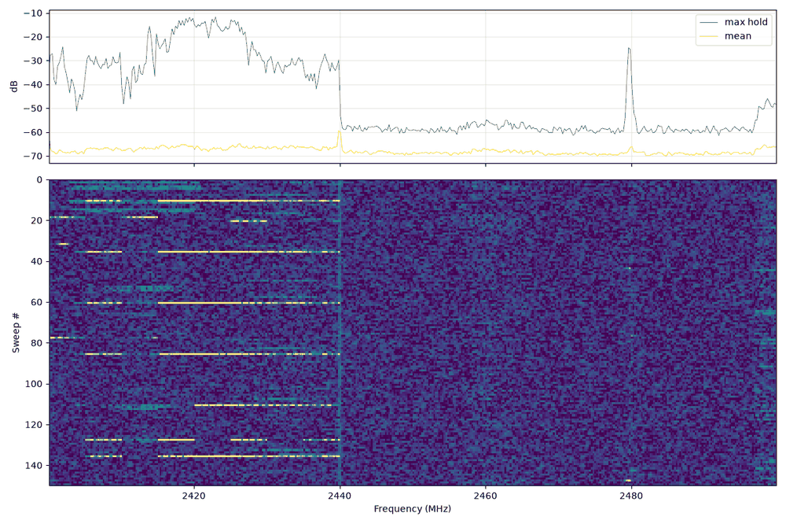

# HackRF One

The HackRF One (Great Scott Gadgets) is a half-duplex transceiver covering **1 MHz – 6 GHz** at up to
**20 MS/s** with 8-bit samples. It is the bench's **transmitter**: generate IQ with NumPy, replay it with
`hackrf_transfer -t`. It is also a decent wideband receiver and a fast spectrum sweeper (`hackrf_sweep`).

> Verified on this bench (2026-10-14): HackRF One, firmware v2.4.0 (API 1.11), hardware older than r6,
> `libhackrf`/tools 2026.01.3 from Homebrew. TX at 433.92 MHz (gain 20, amp off) was received by an
> RTL-SDR Blog V4 about 1 m away at 40–55 dB SNR, and every generated modulation decoded
> (see [../../signal_generation/12_verifying_over_the_air.md](../../signal_generation/12_verifying_over_the_air.md)).

---

## 1. Specifications that matter

| Item | Value | Notes |
|---|---|---|
| Frequency range | 1 MHz – 6 GHz (tools accept 0–7.25 GHz with `-F` force) | Performance drops below ~10 MHz and above ~4 GHz |
| Sample rate | 2 – 20 MS/s (complex) | < 2 MS/s is not supported by the MAX5864/CPLD path; use 2, 4, 8, 10, 16 or 20 MS/s |
| Sample format | CS8: signed 8-bit I, Q interleaved | ~48 dB theoretical dynamic range (8 bits). Real-world SFDR ~ 40–50 dB |
| Duplex | Half duplex | Cannot RX and TX at the same time. Use a second radio to monitor your own TX |
| USB | USB 2.0 High-Speed | 20 MS/s × 2 bytes = 40 MB/s, near the practical USB 2 limit. Other devices on the same bus cause drops |
| Baseband filter (MAX2837) | 1.75, 2.5, 3.5, 5, 5.5, 6, 7, 8, 9, 10, 12, 14, 15, 20, 24, 28 MHz | Default is the largest value ≤ 0.75 × sample rate. Set with `-b` |
| RX gain stages | RF amp 0/~11–14 dB (`-a`), LNA (IF) 0–40 dB in 8 dB steps (`-l`), VGA (baseband) 0–62 dB in 2 dB steps (`-g`) | |
| TX gain stages | RF amp 0/~14 dB (`-a`), TX VGA (IF) 0–47 dB in 1 dB steps (`-x`) | |
| Max RX input | **−5 dBm** | More can permanently damage the front end. Never connect a transmitter directly. Use ≥ 30 dB of attenuation for cable tests |
| TX output power (approx.) | 1 MHz–10 MHz: 5–15 dBm; 10 MHz–2.15 GHz: 5–15 dBm, falling with frequency; 2.15–2.75 GHz: 13–15 dBm; 2.75–4 GHz: 0–5 dBm; 4–6 GHz: −10–0 dBm | These are maxima with the amp on and full VGA. Per Great Scott Gadgets docs |
| Clock | Internal crystal (typ. ±10–20 ppm), CLKIN/CLKOUT 10 MHz SMA | Measured on this bench: HackRF + RTL combined error about +5 ppm (+2.2 kHz at 434 MHz) |
| Antenna port power | 3.3 V, 50 mA max (`-p 1` or `hackrf_biast`) | For LNAs. Never into a DC-shorted antenna or a signal generator |
| Image rejection | Mixer + RFFC5072. `-m` 0 bypass, 1 low pass, 2 high pass | The tools choose automatically. Override only when debugging spurs |

**Frequency plan (why spurs move):** below ~2.15 GHz the RFFC5072 mixes up to a 2.3–2.7 GHz IF, which the
MAX2837 then brings to baseband. Above 2.75 GHz it mixes down. Near **2.15–2.75 GHz** the IF path is used
directly. Spurs and image responses therefore depend on the band. If a "signal" moves when you shift the
centre frequency by 100 kHz but its offset stays the same, it is a spur, not a signal.

---

## 2. Install and first contact

```bash
# macOS
brew install hackrf
# Debian / Ubuntu / Raspberry Pi OS
sudo apt install hackrf libhackrf-dev
# Linux USB permissions (the hackrf package ships a udev rule; otherwise):
sudo usermod -aG plugdev $USER   # then log out/in
```

```bash
hackrf_info
```

```text
hackrf_info version: 2026.01.3
libhackrf version: 2026.01.3 (0.9.2)
Found HackRF
Index: 0
Serial number: 0000000000000000xxxxxxxxxxxxxxxx
Board ID Number: 2 (HackRF One)
Firmware Version: v2.4.0 (API:1.11)
Part ID Number: 0xa000cb3c 0x00584762
Hardware Revision: older than r6
Hardware supported by installed firmware:
    HackRF One
There are 6 other devices on the same USB bus.
You may have problems at high sample rates.
```

Read this output every session:

- **Firmware vs library version.** Keep the firmware at the release that matches your `libhackrf`. A
  mismatch causes odd failures such as `hackrf_sweep` hanging or "API version" errors.
- **"other devices on the same USB bus"** warns that sustained 20 MS/s may drop samples. Use 8–10 MS/s or
  move the HackRF to its own USB controller.
- With several HackRFs attached, pass `-d <serial>` to every tool.

### Firmware update

```bash
# Download the release that matches your tools (github.com/greatscottgadgets/hackrf/releases), then:
hackrf_spiflash -w firmware-bin/hackrf_one_usb.bin
# Press RESET (or replug), then confirm:
hackrf_info
```

If the board is bricked (no `hackrf_info` response), hold the **DFU** button while pressing **RESET** to
enter DFU mode, then:

```bash
dfu-util --device 1fc9:000c --alt 0 --download firmware-bin/hackrf_one_usb.dfu
hackrf_spiflash -w firmware-bin/hackrf_one_usb.bin   # then RESET
```

Firmware since 2021 loads the CPLD bitstream itself. `hackrf_cpldjtag` is only needed for very old firmware.

---

## 3. `hackrf_transfer`: raw IQ in and out

`hackrf_transfer` is the workhorse. It runs until stopped unless you pass `-n` (sample count) or give it a
finite TX file (without `-R`).

### Flags

| Flag | Meaning |
|---|---|
| `-r <file>` | Receive to file (`-` = stdout). CS8 |
| `-t <file>` | Transmit from file (`-` = stdin). CS8 |
| `-w` | Receive to an auto-named WAV (SDR# style `HackRF_<date>_<time>Z_<freq>kHz_IQ.wav`) |
| `-f <hz>` | Centre frequency (1 MHz – 6 GHz) |
| `-s <hz>` | Sample rate (2–20 MHz). Default 10 MHz, so pass it explicitly |
| `-n <N>` | Number of samples, then exit |
| `-l <dB>` | RX LNA/IF gain, 0–40, step 8 |
| `-g <dB>` | RX VGA/baseband gain, 0–62, step 2 |
| `-x <dB>` | TX VGA gain, 0–47, step 1 |
| `-a 0/1` | RF amplifier (RX and TX). Default off |
| `-p 0/1` | Antenna port power (3.3 V bias tee) |
| `-b <hz>` | Baseband filter bandwidth (see table above) |
| `-R` | Repeat the TX file until stopped |
| `-c <0-127>` | CW mode: transmit a constant DC value, which gives a carrier exactly at `-f` (LO leakage + DC) |
| `-C <ppm>` | Crystal error correction in ppm |
| `-S <bytes>` | RX streaming buffer size |
| `-B` | Print buffer statistics (helps diagnose USB drops) |
| `-H` | Wait for the hardware trigger input before streaming |
| `-i <hz>` / `-o <hz>` / `-m <0-2>` | Manual IF, LO and image-reject filter (expert / spur debugging) |
| `-d <serial>` | Choose the device |
| `-F` | Force out-of-range parameters |

### Receive

```bash
# 2 seconds of 433.92 MHz at 2 MS/s: 4,000,000 samples = 8 MB CS8
hackrf_transfer -r keyfob.cs8 -f 433920000 -s 2000000 -n 4000000 -l 24 -g 20 -a 0

# FM broadcast band chunk at 8 MS/s (verified here: 16 M samples -> 32 MB in 2 s)
hackrf_transfer -r fm.cs8 -f 97500000 -s 8000000 -n 16000000 -l 24 -g 20 -a 0

# Stream to Python without a file
hackrf_transfer -r - -f 915000000 -s 4000000 -n 4000000 -l 32 -g 30 | python3 my_rx.py
```

File size = samples × 2 bytes. At 8 MS/s that is **16 MB/s**, and at 20 MS/s it is **40 MB/s**. Keep
captures to seconds.

**Gain staging (RX).** Start with `-a 0 -l 16 -g 20`. Raise LNA (`-l`) first in 8 dB steps until the noise
floor lifts slightly, then VGA (`-g`). Enable the amp (`-a 1`) only for weak signals and never near strong
transmitters. Overload shows up as a raised floor, many new spurs, mirrored copies of strong signals, and
samples hitting ±127. Check with `tools/iq_inspect.py` (`clipped_fraction`).

### Transmit

```bash
# Generate (see signal_generation/), then transmit the file once:
hackrf_transfer -t signal.cs8 -f 433920000 -s 2000000 -x 20 -a 0
```

Or use the helper in this folder, which prints the file's duration, replays it N times with a gap, and can
show the command without running it:

```bash
python3 radios/hackrf/tools/hackrf_tx.py signal.cs8 --freq 433.92e6 --rate 2e6 --gain 20
python3 radios/hackrf/tools/hackrf_tx.py signal.cs8 --freq 915e6 --rate 8e6 --gain 30 --amp --repeat 3 --gap 1
python3 radios/hackrf/tools/hackrf_tx.py --dry-run signal.cs8 --freq 2.44e9 --rate 10e6 --gain 40
python3 radios/hackrf/tools/hackrf_tx.py signal.cs8 --freq 433.92e6 --rate 2e6 --extra "-b 1750000 -C 2"
```

TX notes:

1. **The file's sample rate and `-s` must match.** If they don't, the signal comes out at the wrong
   bandwidth and offset (a 100 kHz offset generated at 2 MS/s becomes 400 kHz at 8 MS/s).
2. **Generate with headroom.** Scale IQ to about 80 % of full scale (±100 of ±127). Clipping in the 8-bit DAC
   creates harmonics and splatter. `rfkit.iq.save(..., peak=0.8)` does this by default.
3. **Offset the signal from the centre** (e.g. +100 kHz). The HackRF leaks its LO and DC at exactly `-f`.
   You'll see a small carrier there even with an all-zero file. Measured here: centre leakage (plus the
   receiver's own DC spike) is 48–58 dB below the wanted signal, and the mirror image at −offset is
   51–57 dB below.
4. **Output level.** TX VGA (`-x`, 0–47 dB) plus the optional amp (`-a 1`, ~+14 dB). For reference, at
   1 m on this bench `-x 20` with the amp off gave 40–55 dB SNR on an RTL-SDR.
5. **Load.** Transmit into an antenna or a 50 Ω load. For cabled tests, put 30–40 dB of attenuation before
   the receiver (receiver input limits are in the spec tables).
6. **Still running?** `pgrep -lf hackrf_transfer` lists any transmitter still active (e.g. one started with
   `-R`).

### Quick carrier (no file)

```bash
hackrf_transfer -c 100 -f 433920000 -s 2000000 -x 10 -a 0   # CW at exactly 433.92 MHz until stopped
```

---

## 4. `hackrf_sweep`: fast spectrum survey

`hackrf_sweep` retunes in 20 MHz steps and FFTs each step. It can cover the whole 1 MHz–6 GHz range in
about a second, far faster than `rtl_power`.

```bash
hackrf_sweep -f 88:108 -w 100000 -l 24 -g 20 -1 -r sweep_fm.csv     # one sweep, FM band, 100 kHz bins
hackrf_sweep -f 2400:2500 -w 500000 -N 50 -r wifi.csv               # 50 sweeps of 2.4 GHz
hackrf_sweep -f 1:6000 -w 1000000 -N 5 -r all.csv                    # whole range, 1 MHz bins
python3 tools/sweep_plot.py sweep_fm.csv                              # heatmap PNG + strongest frequencies
```

| Flag | Meaning |
|---|---|
| `-f min:max` | Range in **MHz** (integers) |
| `-w <hz>` | FFT bin width, 2445 – 5,000,000 Hz |
| `-1` | One sweep then exit |
| `-N <n>` | Number of sweeps then exit (without `-1`/`-N` it sweeps until stopped) |
| `-l` / `-g` / `-a` / `-p` | LNA, VGA, amp, antenna power, as for `hackrf_transfer` |
| `-r <file>` | Output file (default stdout) |
| `-B` / `-I` | Binary output / binary inverse-FFT output |
| `-n` | Same timestamp for every row of a sweep |
| `-W <file>` / `-P <plan>` | FFTW wisdom file / plan type |

Output rows (also the `rtl_power` format):

```text
date, time, hz_low, hz_high, hz_bin_width, num_samples, dB, dB, dB, ...
2026-10-14, 12:53:54.184327, 88000000, 93000000, 98039.22, 204, -71.73, -77.66, ...
```

Each row covers a 5 MHz slice. hackrf_sweep emits the slices out of order and, without `-n`, with
different timestamps, so `tools/sweep_plot.py` starts a new sweep whenever a slice repeats. The dB values
are **relative** (uncalibrated). Compare them with each other, not with a power meter.



*`hackrf_sweep -f 2400:2500 -w 250000 -l 32 -g 24 -N 150` on this bench, plotted with `tools/sweep_plot.py`
(top: max-hold and mean; bottom: one row per sweep). Wi-Fi bursts occupy 2.40–2.44 GHz; the narrow line at
2.480 GHz is consistent with BLE advertising channel 39. 150 sweeps took a few seconds.*

---

## 5. Other utilities

| Tool | Use |
|---|---|
| `hackrf_info` | Detect boards, serials, firmware |
| `hackrf_clock -i` / `-o 1` / `-a` | CLKIN status / enable CLKOUT / read all clock settings. Feed 10 MHz into CLKIN to lock to a GPSDO or another radio |
| `hackrf_biast -b 1` / `-r on` | Antenna power now / by default in RX mode (for software that cannot set it) |
| `hackrf_operacake -l`, `-a/-b`, `-f port:min:max`, `-m time` | Control an Opera Cake antenna switch |
| `hackrf_spiflash -w/-r` | Write/read firmware flash |
| `hackrf_debug` | Read/write MAX2837/Si5351/RFFC5072 registers (expert) |
| `hackrf_cpldjtag` | Legacy CPLD programming (not needed with modern firmware) |

---

## 6. Using the HackRF from other software

| Software | How |
|---|---|
| **SDR++** | Source → HackRF. Sample rate, LNA, VGA, amp and bias tee in the source panel. Saved in `hackrf_config.json` (`lnaGain`, `vgaGain`, `amp`, `bandwidth` index, where 16 = Auto). See [../../software/sdr++/README.md](../../software/sdr++/README.md) |
| **GNU Radio** | `osmocom Source/Sink` (gr-osmosdr, args `hackrf=0`) or `Soapy HackRF Source/Sink` |
| **SoapySDR** | `SoapySDRUtil --find="driver=hackrf"`, gains `AMP`, `LNA`, `VGA` (RX) / `AMP`, `VGA` (TX) |
| **Python** | Easiest: subprocess `hackrf_transfer -r -` and `np.frombuffer(..., np.int8)`. Native bindings: `python_hackrf` (pip) or SoapySDR's Python module |
| **URH, Inspectrum, rtl_433** | URH records/replays directly. Inspectrum opens `.cs8`. `rtl_433` reads CS8 files with `-r file.cs8` (filename must include the rate, e.g. `name_2M.cs8`) |

Python receive via subprocess (no extra packages):

```python
import subprocess, numpy as np
fs, n = 2_000_000, 2_000_000
raw = subprocess.run(["hackrf_transfer", "-r", "-", "-f", "433920000", "-s", str(fs), "-n", str(n),
                      "-l", "24", "-g", "20", "-a", "0"], capture_output=True, check=True).stdout
x = np.frombuffer(raw, np.int8).astype(np.float32).view(np.complex64) / 128   # I,Q pairs -> complex
```

`astype(np.float32).view(np.complex64)` works because consecutive float32 values (I, Q) are exactly the
memory layout of one complex64. Same trick for CU8 after subtracting 127.5.

---

## 7. Troubleshooting

| Symptom | Cause / fix |
|---|---|
| `hackrf_open() failed: HACKRF_ERROR_NOT_FOUND` | Not enumerated: cable, port, permissions (Linux udev/plugdev), or another program (SDR++, GQRX) has it open |
| `HACKRF_ERROR_BUSY` / resource busy | Another process is using it. `pgrep -lf "hackrf|sdrpp|gqrx"` |
| Output is all zeros or tiny | Gains at 0, or the wrong antenna port (it's the SMA marked ANTENNA) |
| Signal at the wrong place or the wrong width on TX | `-s` doesn't match the generation rate, or I/Q are swapped (mirror image) |
| Spurs / splatter on TX | Clipping (lower `peak` or `-x`), hard edges (shape them), or the amp is on |
| "Couldn't transfer any bytes" / dropped samples | USB bandwidth. Lower the rate, use a direct port or a different controller, close other USB devices. Check with `-B` |
| Hangs on exit | Old firmware/library mismatch. Update both. Unplug and replug |
| Constant carrier at the exact centre | LO leakage + DC offset (normal). Offset your signal, or use `dsp.dc_block` on RX |
| Signal is a few kHz off | Crystal ppm error. Measure it on a known carrier and use `-C ppm`, or let the decoder search |
| Strong FM stations everywhere at random frequencies | Front-end overload / images. Lower LNA/amp, add an FM band-stop filter |

---

## 8. Bench facts measured here

- Combined HackRF TX + RTL-SDR V4 RX frequency error at 433.92 MHz: **+2.15 to +2.18 kHz** (~5 ppm).
  Decoders should search ±10 kHz for narrowband work.
- TX gain 20, amp off, about 1 m: carrier SNR 53 dB, OOK 43 dB, 2-FSK 38 dB, BPSK/QPSK (50 kBd) 16–18 dB
  in the RTL-SDR's 1.024 MHz span, with RTL gain index 20 (37.2 dB).
- With the signal offset +100 kHz, the residual carrier at the tuned centre (LO leakage plus RTL DC) is
  48–58 dB below the signal, and the IQ-imbalance image at −100 kHz is 51–57 dB below.
