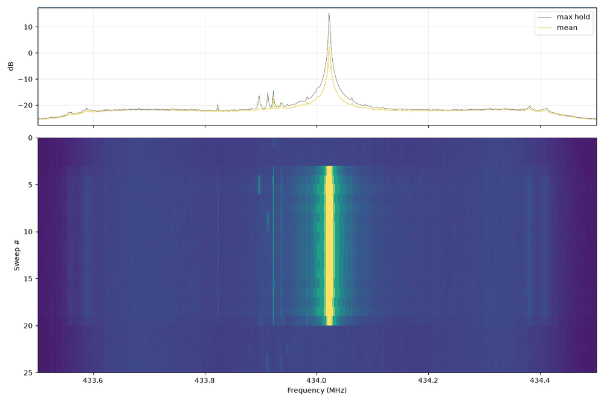

# RTL-SDR (RTL-SDR Blog V4 and other RTL2832U dongles)

RTL-SDR dongles are cheap, receive-only DVB-T sticks (Realtek RTL2832U demodulator plus a tuner chip) whose
raw IQ mode turns them into an SDR. The **RTL-SDR Blog V4** is the bench **receiver**. It watches the
HackRF's transmissions, records IQ through SDR++ or `rtl_sdr`, and runs `rtl_433`/`rtl_power` surveys.

> Verified on this bench (2026-10-14): RTL-SDR Blog V4 (R828D tuner, serial 00000001), Homebrew `librtlsdr`
> 2.0.2 (detects the V4 natively: "RTL-SDR Blog V4 Detected"), `rtl_433` 25.12. Used at 1.024 and
> 2.048 MS/s from SDR++ and the command line.

---

## 1. Specifications (RTL-SDR Blog V4)

| Item | Value | Notes |
|---|---|---|
| Frequency range | ~500 kHz – 1.766 GHz | HF (< 28.8 MHz) works through the V4's built-in upconverter, which switches automatically. No direct-sampling mode is needed |
| Tuner | Rafael Micro **R828D** | V3 and most generics use the R820T/R820T2. E4000 / FC0012 / FC0013 on very old sticks |
| ADC | 8-bit (RTL2832U), ~7 ENOB | ~45 dB instantaneous dynamic range. Strong signals anywhere in the span raise everything |
| Sample rates | 225,001 – 300,000 and 900,001 – 3,200,000 S/s | **2.4 MS/s is the highest rate that's reliable without drops**; 2.56 MS/s often works; 2.048, 1.024 and 0.25 MS/s are the classic safe values |
| Usable bandwidth | ≈ sample rate (complex), with roll-off at the edges | Keep targets inside the middle ~80 % |
| Sample format | CU8: unsigned 8-bit I, Q interleaved, 127.5 = zero | `rtl_sdr` output. SDR++ records int16 WAV instead |
| Gain | 29 discrete steps, 0 – 49.6 dB (see table below) | Plus "auto" (tuner AGC) and the separate RTL digital AGC |
| Frequency reference | 1 ppm TCXO | Initial error usually < 2 ppm. Drifts a little while warming up |
| Bias tee | 4.5 V, ~180 mA, software-enabled (`rtl_biast -b 1` or `-T`) | Powers LNAs / active antennas. Off by default |
| Front-end filtering | Triplexer (HF / VHF / UHF paths) plus notches for AM and FM broadcast | V4 handles strong FM stations much better than V3 |
| Input limit | Keep below about **−10 dBm**. Damage around +10 dBm | ESD-protected, but never connect a transmitter without ≥ 30–40 dB of attenuation |
| Connector / USB | SMA female, USB 2.0 (Type-C on V4) | |

Gain steps reported by `rtl_test` on this V4 (index → dB). SDR++ stores the **index**:

```text
idx:  0    1    2    3    4    5    6    7     8     9     10    11    12    13    14
dB:  0.0  0.9  1.4  2.7  3.7  7.7  8.7  12.5  14.4  15.7  16.6  19.7  20.7  22.9  25.4
idx:  15    16    17    18    19    20    21    22    23    24    25    26    27    28
dB:  28.0  29.7  32.8  33.8  36.4  37.2  38.6  40.2  42.1  43.4  43.9  44.5  48.0  49.6
```

`rtl_sdr -g 30` asks for 30 dB and gets the nearest step (29.7). Index 20 (37.2 dB) was the right gain for
HackRF-at-1-m bench work at 433 MHz. Use 40–49.6 dB for weak, distant signals with a good antenna.

---

## 2. Install and first contact

```bash
# macOS (Homebrew librtlsdr 2.0.2 supports the V4 directly)
brew install librtlsdr rtl_433
# Debian / Ubuntu: distro packages older than 2.0.2 do NOT know the V4 (tuning is wrong / no HF).
#   Build the RTL-SDR Blog fork: https://github.com/rtlsdrblog/rtl-sdr-blog  (cmake ../ -DINSTALL_UDEV_RULES=ON)
# Linux: stop the kernel DVB driver from claiming the stick
echo 'blacklist dvb_usb_rtl28xxu' | sudo tee /etc/modprobe.d/blacklist-rtl.conf && sudo modprobe -r dvb_usb_rtl28xxu
```

```bash
rtl_test -t        # -t = tuner/benchmark info, exits on its own
```

```text
Found 1 device(s):
  0:  RTLSDRBlog, Blog V4, SN: 00000001
Using device 0: Generic RTL2832U OEM
Found Rafael Micro R828D tuner
RTL-SDR Blog V4 Detected
Supported gain values (29): 0.0 0.9 1.4 2.7 3.7 7.7 8.7 12.5 14.4 15.7 16.6 19.7 20.7 22.9 25.4 28.0 29.7 32.8 ...
Sampling at 2048000 S/s.
No E4000 tuner found, aborting.
```

"No E4000 tuner found, aborting" is normal. `-t` only runs the E4000 tuner-range test. If you **don't**
see "RTL-SDR Blog V4 Detected" on a V4, your librtlsdr is too old.

Other `rtl_test` uses:

```bash
rtl_test -s 2400000      # sample-drop test at 2.4 MS/s ("lost at least N bytes" = USB trouble)
rtl_test -p             # estimate crystal ppm error against the system clock (let it run 1-2 min)
```

**Only one program can open the dongle at a time.** If anything says "usb_claim_interface error -6", close
SDR++/GQRX/rtl_433/rtl_tcp first (`pgrep -lf "rtl_|sdrpp|gqrx"`).

---

## 3. Command-line tools

All of these stream until stopped unless given a length: `-n` (samples), `-1` or `-e` (rtl_power),
`-T` (rtl_433), or a `gtimeout N` wrapper.

### `rtl_sdr`: raw IQ to a file

```bash
# 2 s of 433.92 MHz at 2.048 MS/s -> 4,096,000 samples = 8.2 MB CU8
rtl_sdr -f 433920000 -s 2048000 -g 37.2 -n 4096000 capture.cu8
# FM station (verified here)
rtl_sdr -f 97500000 -s 2048000 -g 30 -n 4096000 fm.cu8
# pipe to Python
rtl_sdr -f 433920000 -s 1024000 -g 37.2 -n 2048000 - | python3 my_rx.py
```

| Flag | Meaning |
|---|---|
| `-f <hz>` | Centre frequency (accepts `433.92e6`, `433920000`) |
| `-s <hz>` | Sample rate (default 2,048,000) |
| `-g <dB>` | Tuner gain in dB (nearest step). `0` = auto/AGC |
| `-p <ppm>` | Frequency correction |
| `-n <N>` | Number of samples, then exit (0 = until stopped) |
| `-d <idx or serial>` | Choose the device |
| `-D` | Direct sampling (V3 HF only. Not used on V4) |
| `-S` | Synchronous output |
| `-b` | Output block size |

Load in Python (or use `rfkit.iq.load("capture.cu8", fs=2.048e6)`):

```python
import numpy as np
raw = np.fromfile("capture.cu8", dtype=np.uint8).astype(np.float32)
x = ((raw - 127.5) / 127.5).view(np.complex64)     # I,Q pairs -> complex, scaled to about [-1, 1]
```

### `rtl_fm`: demodulate to audio

```bash
# Broadcast FM -> WAV (verified: 2 s of audio from 97.5 MHz)
rtl_fm -M wbfm -f 97.5M -g 30 | sox -t raw -r 32k -e signed -b 16 -c 1 - fm.wav
# NFM voice / data at 12.5 kHz channel, squelch 50, 24 kHz audio -> play
rtl_fm -M fm -f 462.5625M -s 24k -l 50 -g 40 | play -t raw -r 24k -e s -b 16 -c 1 -V1 -
# Scan a list / a range (needs squelch)
rtl_fm -M fm -f 162.400M -f 162.425M -f 162.450M -f 162.475M -f 162.500M -f 162.525M -f 162.550M -s 22050 -l 30
# POCSAG pager decoding with multimon-ng
rtl_fm -M fm -f 152.24M -s 22050 -g 40 | multimon-ng -t raw -a POCSAG512 -a POCSAG1200 -a POCSAG2400 -
# AM airband
rtl_fm -M am -f 118M:137M:25k -s 12k -l 70 -g 45 | play -t raw -r 12k -e s -b 16 -c 1 -
# Raw IQ at a low rate (2 x int16) for narrowband work
rtl_fm -M raw -f 433.92M -s 250k -g 37 -n 0 > iq_250k.cs16
```

| Flag | Meaning |
|---|---|
| `-M fm, wbfm, am, usb, lsb, raw` | Demodulator. `wbfm` = `-M fm -s 170k -o 4 -A fast -r 32k -l 0 -E deemp` |
| `-s <rate>` | Channel sample rate (default 24k). `-r` resamples the output |
| `-l <level>` | Squelch. Needed for scanning with multiple `-f` |
| `-E deemp / dc / edge / offset / direct` | De-emphasis, DC block, lower-edge tuning, offset tuning, direct sampling |
| `-F 9` | Better downsampling FIR |
| `-A fast` | Faster atan |
| `-T` | Bias tee on |

Output is **signed 16-bit little-endian mono** at the output rate. `-M raw` gives 2 × int16 IQ.

### `rtl_power`: spectrum survey / long-term logging

```bash
rtl_power -f 88M:108M:100k -g 30 -i 2 -1 fm_band.csv          # one 2-second integration (verified)
rtl_power -f 400M:470M:12.5k -g 40 -i 10 -e 1h uhf.csv         # log an hour of UHF activity, 10 s per row
rtl_power -f 24M:1.7G:1M -i 5m -1 -c 25% survey.csv            # everything, 5-minute integration
python3 tools/sweep_plot.py fm_band.csv                         # heatmap PNG + strongest frequencies
```



*`rtl_power -f 433.5M:434.5M:2k -g 37 -i 1 -e 25` while the HackRF transmitted 40 OOK packets at
433.92 MHz + 100 kHz (sweeps 3–19). `sweep_plot.py` reports 434.0225 MHz, 37.8 dB over the floor, duty 0.68.
The faint lines near 433.92 MHz are the HackRF's LO leakage and spurs.*

Same CSV layout as `hackrf_sweep`: `date, time, hz_low, hz_high, hz_step, samples, dB, dB, ...`. It is much
slower than `hackrf_sweep` (the dongle retunes every ~2 MHz), but you can leave it running for days.
Options: `-i` integration time, `-1` single shot, `-e` exit timer (`30m`, `1h`), `-c` crop percentage
(drops the edges of each hop where the filter rolls off), `-w hamming|blackman|...`, `-P` peak hold, `-O`
offset tuning.

### `rtl_433`: decode ISM-band gadgets (and analyse unknown OOK/FSK)

```bash
rtl_433 -f 433.92M -T 60 -F json                   # 60 s of everything rtl_433 knows (200+ protocols)
rtl_433 -f 915M -s 1024k -T 60 -F json             # US 915 MHz devices
rtl_433 -f 433.92M -A -T 30                        # pulse analyzer on anything it hears
rtl_433 -f 433.92M -S unknown -T 120               # save unknown signals as .cu8 for offline study
rtl_433 -r cu8:capture.cu8 -s 1024k -A -R 0        # analyse a recording (prefix the format if the name is odd)
```

Real example: the analyzer run on this bench's over-the-air OOK test packet (generated by
`signal_generation/generate.py ook --text "OOK HELLO" --rate 1000`):

```text
Detected OOK package  @1.161343s
Pulse width distribution:
 [ 0] count:   28,  width:  984 us [981;1000]
 [ 1] count:    4,  width: 1983 us ...
Gap width distribution:
 [ 0] count:   20,  width: 1015 us ...
RSSI: -3.6 dB SNR: 20.0 dB Noise: -23.6 dB
Frequency offsets [F1, F2]:    6732,      0  (+105.2 kHz, +0.0 kHz)
Guessing modulation: Non Return to Zero coding (Pulse Code)
```

All widths are multiples of ~1000 µs, so it's NRZ at 1000 bit/s. A flexible decoder then pulls out the
bytes after the `AA AA 2D D4` preamble+sync:

```bash
rtl_433 -r cu8:capture.cu8 -s 1024k -R 0 -F json \
  -X "n=rfagent,m=OOK_PCM,s=1000,l=1000,r=8000,preamble=aaaa2dd4"
# {"model" : "rfagent", ... "codes" : ["{104}094f4f4b2048454c4c4fd7b900"]}
#   09 = length, 4f4f4b2048454c4c4f = "OOK HELLO", d7b9 = CRC-16
```

Flex `-X` keys: `m=` OOK_PCM | OOK_PPM | OOK_PWM | OOK_MC_ZEROBIT | FSK_PCM | FSK_PWM | ..., `s=` short
(µs), `l=` long, `r=` reset/gap limit, `g=` gap, `t=` tolerance, `preamble=`, `bits>=`, `repeats>=`.
`rtl_433 -X help` lists them all.

### `rtl_tcp`: share the dongle over the network

```bash
rtl_tcp -a 127.0.0.1 -p 1234 -f 433920000 -s 2048000 -g 37
# Clients: SDR++ (RTL-TCP source), GQRX (rtl_tcp=127.0.0.1:1234), GNU Radio osmocom, rtl_433 -d rtl_tcp://127.0.0.1:1234
```

Bind to `127.0.0.1` unless you mean to expose the radio. The protocol has no authentication.

### Others

| Tool | Use |
|---|---|
| `rtl_adsb` | Basic 1090 MHz ADS-B decoder (`dump1090`/`readsb` are far better) |
| `rtl_biast -b 1` / `-b 0` | Bias tee on/off (V3/V4). Make sure the antenna/LNA expects DC |
| `rtl_eeprom` | Read/write EEPROM: `-s <serial>` gives each dongle a unique serial so `-d <serial>` can tell them apart. **Dump first** (`-r backup.bin`) |
| `multimon-ng` | POCSAG/FLEX/AFSK/DTMF/EAS decoding from `rtl_fm` audio |
| `kalibrate-rtl` (`kal`) | Measure ppm against GSM base stations (where GSM still exists) |
| `dump1090`, `AIS-catcher`, `acarsdec`, `dumpvdl2`, `noaa-apt`, `SatDump` | Purpose-built decoders that sit on an RTL-SDR |

---

## 4. Getting good captures

1. **Centre slightly off the target.** The RTL2832U has a DC spike at exactly the centre. Put the signal at
   +50 to +200 kHz, or enable offset tuning in SDR++.
2. **Pick the rate for the signal, not the maximum.** 1.024 MS/s is plenty for anything under ~800 kHz wide
   and halves the file size of 2.048. Narrowband work (CW, POCSAG, OOK remotes) is fine at 250 kS/s.
3. **Gain: lowest that lifts the signal clearly.** Too much gain raises the floor and creates images and
   intermod ("ghost" copies of strong stations). Watch for clipping. `tools/iq_inspect.py` reports
   `clipped_fraction`.
4. **Turn the AGCs off** for measurement or decoding (`rtlAgc`/`tunerAgc` false in SDR++). AGC changes the
   level mid-packet and breaks OOK thresholds.
5. **Calibrate ppm once per dongle.** Measure a known carrier (a HackRF tone, a NOAA weather station, an
   ADS-B/aircraft band reference, a GSM/LTE cell), then set `-p` / SDR++ PPM. A V4's TCXO is usually
   within 1–2 ppm. Most of the ~5 ppm offset seen on this bench is the HackRF.
6. **Set the capture length** with `-n` on `rtl_sdr`, `-1`/`-e` on `rtl_power`, `-T` on `rtl_433`.

File sizes: CU8 = 2 bytes/sample → **2.048 MS/s = 4.1 MB/s**. SDR++ WAV (int16) = 4 bytes/sample →
**8.2 MB/s at 2.048 MS/s** (measured here: 3 s → 24.6 MB).

---

## 5. Using it from other software

| Software | How |
|---|---|
| **SDR++** | Source → RTL-SDR. Saved in `rtl_sdr_config.json` (`gain` index, `sampleRate`, `ppm`, `biasT`, `rtlAgc`, `tunerAgc`, `offsetTuning`, `directSampling`). See [../../software/sdr++/README.md](../../software/sdr++/README.md) |
| **GNU Radio** | `osmocom Source` (args `rtl=0`) or `Soapy RTLSDR Source` |
| **SoapySDR** | `SoapySDRUtil --find="driver=rtlsdr"`. `brew install soapyrtlsdr` |
| **Python** | Subprocess `rtl_sdr -` (shown above). Or `pyrtlsdr` (`pip install pyrtlsdr`): `RtlSdr(); sdr.sample_rate=2.048e6; sdr.center_freq=433.92e6; sdr.gain=37.2; x=sdr.read_samples(1<<20)` |
| **rtl_433 / dump1090 / multimon-ng** | Direct (they open the dongle themselves) |

---

## 6. Troubleshooting

| Symptom | Cause / fix |
|---|---|
| `usb_claim_interface error -6` | Another program has the dongle, or (Linux) the DVB kernel driver. Close it / blacklist `dvb_usb_rtl28xxu` |
| `No supported devices found` | Cable/port, or an old librtlsdr that doesn't recognise the stick |
| V4 tunes wrong or no HF | librtlsdr older than 2.0.2 / not the RTL-SDR Blog fork |
| `lost at least N bytes` / choppy waterfall | USB bandwidth or CPU. Lower the sample rate (≤ 2.4 MS/s), use a USB 2 port directly (not a hub) |
| Everything a few kHz off | ppm error. Calibrate (§4.5) |
| Spike in the middle | DC offset: offset-tune, or `dsp.dc_block()` offline |
| Copies of strong signals at wrong frequencies | Overload/images. Lower gain, add a band filter (FM notch), move away from transmitters |
| Dongle gets hot / unstable at 2.56–3.2 MS/s | Normal for RTL2832U. Stay at ≤ 2.4 MS/s for long captures |
