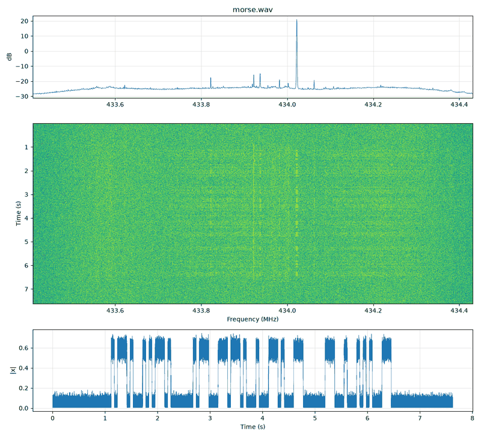
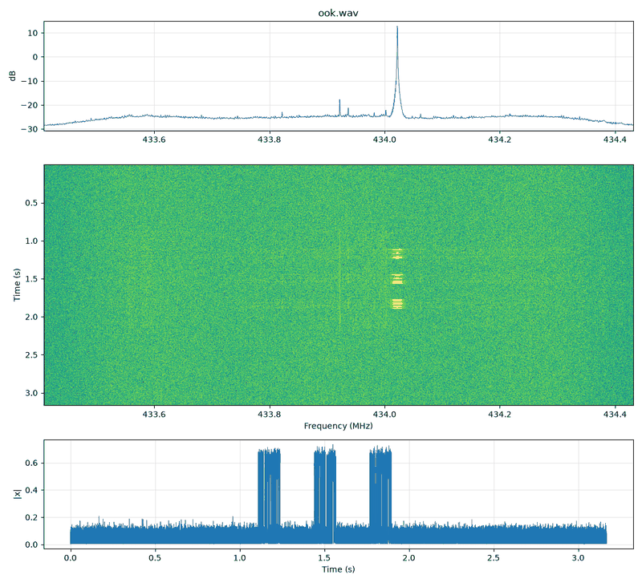

# 03 · Amplitude keying: Morse (CW), OOK, PWM remotes, ASK

All amplitude-keyed signals are **a real envelope times a carrier**:

```python
x = envelope * np.exp(2j * np.pi * offset_hz * t)        # envelope >= 0, same length as t
```

The envelope is built from symbols with `np.repeat` (symbols → samples), then its edges are smoothed.

## Morse code (CW)

International Morse timing in units (PARIS standard: a dot unit is **1.2 / WPM seconds**):

| Element | Units |
|---|---|
| dot (dit) | 1 on |
| dash (dah) | 3 on |
| gap inside a letter | 1 off |
| gap between letters | 3 off |
| gap between words | 7 off |

```python
from rfkit import bits, mod
units = bits.morse_units("CQ TEST")               # array of 0/1 units
env = np.repeat(units.astype(float), int(1.2 / 20 * fs))  # 20 WPM -> 60 ms per unit
env = mod.smooth_envelope(env, int(0.005 * fs))   # 5 ms raised-cosine edges
x = mod.shift(env.astype(np.complex64), 100e3, fs)
# or simply: x = mod.shift(mod.morse("CQ TEST", fs, wpm=20), 100e3, fs)
```

```bash
.venv/bin/python signal_generation/generate.py morse --text "CQ TEST" --wpm 20 -o morse.cs8
.venv/bin/python tools/rx_decode.py morse morse.cs8 --fs 2e6        # -> "CQ TEST", wpm 20
```



### Key clicks: why edges must be shaped

Switching a carrier instantly is multiplying by a square wave, and a square wave's spectrum falls off only
as 1/f. The result is "key clicks": energy tens of kHz either side that other receivers hear. Convolving the
envelope with a Hann window (a raised-cosine edge) makes the spectrum fall off far faster. On the Skinny R&D
bench, hard keying stayed above the noise out to about ±10 kHz, while 5 ms shaped keying fell to the noise
within about 1.5 kHz. Rule of thumb: rise time ≈ 5–10 % of the shortest element (5 ms for CW at 15–25 WPM;
50–100 µs for 1 kbit/s OOK).

## OOK packets

On-off keying sends data the same way: 1 = carrier on, 0 = carrier off, for one bit period each. What turns
it into a usable packet is **framing** (guide 07): preamble, sync word, length, payload, CRC.

```python
from rfkit import bits, mod
b = bits.frame(b"HELLO")                           # AA AA | 2D D4 | 05 | HELLO | CRC16
b = np.concatenate([b, [0]])                       # trailing 0: clean final falling edge
env = np.repeat(b.astype(np.float32), fs // 1000)  # 1 kbit/s
env = mod.smooth_envelope(env, int(0.1 / 1000 * fs))
burst = mod.shift(env.astype(np.complex64), 100e3, fs)
x = mod.pad(mod.repeat_burst(burst, 3, 0.2, fs), fs)     # 3 copies, 200 ms apart, 250 ms silence around
```

```bash
.venv/bin/python signal_generation/generate.py ook --text "HELLO" --rate 1000 --repeat 3 -o ook.cs8
```



Things that matter for the receiver:

- **Runs of zeros have no energy.** The receiver can't tell "0000" from silence, so packets must start with
  a 1-rich preamble and ideally avoid long zero runs (Manchester or whitening).
- **The last bits must be followed by something** if they are 0. A packet ending in zero bits looks
  truncated. rfkit's decoder widens burst edges to cope.
- **Threshold.** Receivers slice the envelope halfway between the on and off levels (Otsu's method in
  `rfkit.dsp.otsu_threshold`). The preamble gives them both levels.

## PWM / PPM remotes (EV1527, PT2262 style)

Cheap 433 MHz remotes encode bits as **pulse widths**: a 1 is a long pulse + short gap, a 0 is a short
pulse + long gap (or the reverse). Each code word is repeated many times with a long sync gap.

```python
x = mod.shift(mod.pwm_ook(bits.from_str("1010 1100 0011 0101 1110 0001"), fs, short_s=350e-6,
                          long_s=1050e-6), 100e3, fs)
```

`rtl_433 -A` identifies these as PWM and prints the short/long widths. See
[../radios/rtl-sdr/README.md](../radios/rtl-sdr/README.md).

## Multi-level ASK

ASK uses several amplitude levels: 2-ASK with levels 0.25/1.0 is OOK that never fully turns off (easier
carrier tracking), 4-ASK carries 2 bits per symbol.

```python
x = mod.ask([0, 3, 1, 2, 3, 0], fs, symbol_rate=1000, levels=(0.1, 0.4, 0.7, 1.0))
```

## Bandwidth summary (measured with rfkit on generated signals)

| Signal | 99 % power bandwidth | Width at −40 dBc |
|---|---|---|
| CW 15 WPM, 5 ms raised-cosine edges | < 100 Hz | ~370 Hz |
| CW 15 WPM, hard keyed | ~120 Hz | ~730 Hz, with skirts that keep going |
| OOK 1 kbit/s, 10 % raised-cosine edges | ~7 kHz | ~15 kHz |
| OOK 1 kbit/s, hard keyed | ~15 kHz | ~21 kHz |

Rule of thumb: shaped OOK needs a channel of about 5–10 × the bit rate; hard keying roughly doubles that,
and its sidelobes are what neighbours hear.
