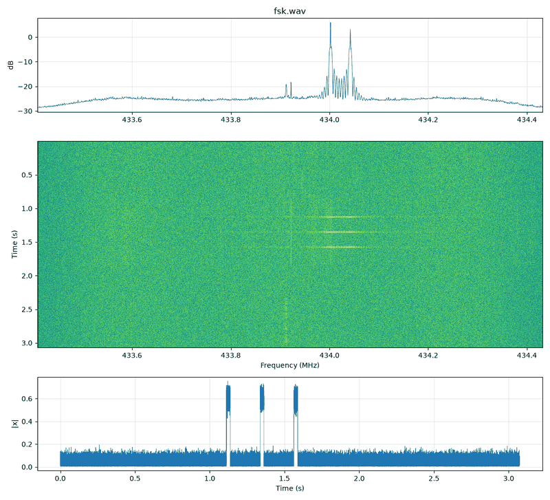
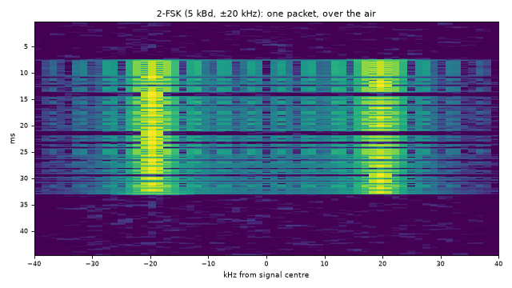
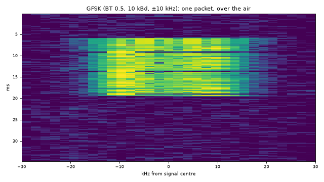

# 04 · Frequency keying: 2-FSK, 4-FSK, GFSK, MSK

FSK keeps the carrier on and moves its **frequency**: a 1 a little above centre, a 0 a little below. The
envelope is constant, which makes FSK robust to fading and amplitude noise and efficient for non-linear
amplifiers. Most sub-GHz IoT radios (CC1101, SX127x FSK mode, Si446x), pagers (POCSAG), Bluetooth (GFSK)
and many telemetry links use it.

## The right way: continuous phase (integrate the frequency)

The naive approach generates two tones and splices them, which leaves a **phase jump** at every bit
boundary and splatters. Instead, describe the instantaneous frequency at every sample and integrate it:

```python
bits_ = bits.frame(b"HELLO")
sym = 2.0 * bits_ - 1.0                                   # 0/1 -> -1/+1
freq = offset_hz + dev_hz * np.repeat(sym, fs // rate)    # Hz at every sample
phase = 2 * np.pi * np.cumsum(freq) / fs                  # integrate -> continuous phase
x = np.exp(1j * phase)
```

`np.cumsum` is a discrete integrator. Phase is the integral of frequency, so phase never jumps, and the
offset can go straight into `freq` instead of a separate shift. Since the envelope is constant, taper only
the ends of each burst (`mod.ramp_edges(x, n)`).

```bash
.venv/bin/python signal_generation/generate.py fsk --text "HELLO" --rate 5000 --dev 20e3 --repeat 3 -o fsk.cs8
```



## Parameters and the modulation index

| Term | Meaning |
|---|---|
| deviation *d* | Peak offset from the centre (tones at ±d) |
| tone spacing | 2d for 2-FSK |
| symbol rate *R* | symbols per second (= bit rate for 2-FSK) |
| modulation index *h* | h = 2d / R = tone spacing / symbol rate |

- **h = 0.5 → MSK** (minimum-shift keying), the narrowest orthogonal FSK: `mod.msk(bits, fs, rate)`.
- **h ≈ 1** is common in simple radios. Larger h (e.g. 8 for ±20 kHz at 5 kbit/s) gives two clearly
  separate tones on a waterfall: easy to see and decode, but wide.
- **Carson's rule:** occupied bandwidth ≈ 2·(d + R). ±20 kHz at 5 kbit/s → ~50 kHz.

## GFSK: Gaussian-filtered FSK (Bluetooth LE, many IoT radios)

Smooth the frequency track with a Gaussian filter before integrating. Transitions become gradual and the
spectrum much tighter. **BT** (bandwidth × symbol time) sets how much: 0.5 for BLE, 0.3 for GSM's GMSK.

```python
x = mod.fsk(bits_, fs, rate, dev_hz, bt=0.5)        # GFSK
x = mod.gmsk(bits_, fs, rate, bt=0.3)               # GMSK = MSK + Gaussian
```

```bash
.venv/bin/python signal_generation/generate.py fsk --bt 0.5 --text "HELLO" --rate 10000 --dev 10e3 -o gfsk.cs8
```

| 2-FSK, h = 8 (±20 kHz at 5 kBd) | GFSK BT 0.5, h = 2 (±10 kHz at 10 kBd) |
|---|---|
|  |  |

*One received packet of each. With a large index the two tones stand apart as rails. With Gaussian
shaping and a smaller index, the energy fills one smooth hump between ±deviation.*

Trade-off: smoothing spreads each bit's frequency into its neighbours (intersymbol interference). With a
low BT, a lone 1 between 0s never reaches full deviation. Receivers need decent timing recovery: on this
bench, a fixed-clock slicer with a 0.8 % rate error lost the end of 120-bit GFSK packets, and the PLL
slicer in `rfkit.dsp.slice_symbols_pll` recovered them all.

## 4-FSK

Two bits per symbol on four tones (−3d, −d, +d, +3d). Gray-code the bit pairs so neighbouring tones differ
by one bit (DMR, P25 C4FM, some telemetry):

```python
pairs = mod.bits_to_symbols(bits_, 2)              # 00,01,10,11 -> 0..3
gray_to_level = np.array([0, 1, 3, 2])             # Gray mapping onto tone index
x = mod.fsk(gray_to_level[pairs], fs, symbol_rate, dev_hz, m=4)
```

```bash
.venv/bin/python signal_generation/generate.py fsk --levels 4 --rate 5000 --dev 5e3 -o 4fsk.cs8
```

## How the receiver sees it

The FM discriminator `angle(x[n]·conj(x[n−1]))·fs/2π` turns FSK back into a two-level (or four-level)
waveform in Hz. Then: post-detection low-pass, estimate the symbol rate from run lengths, slice with a
threshold halfway between the tones (Otsu), frame-sync. `tools/rx_decode.py fsk` does all of it and also
**estimates the carrier offset from the discriminator** (midpoint of the two tones). Spectral peak-picking
is biased by unequal 1/0 counts and sinc sidelobes.

Common receiver pitfalls (they show up as "almost right" bytes):

- Threshold at 0 Hz or at the median, instead of between the tones. Any carrier offset or 1/0 imbalance
  shifts the right threshold.
- Channel filter too narrow or off-centre, so one tone is attenuated.
- Polarity: which tone is a 1? `bits.parse_frame` tries both and reports `inverted`.
