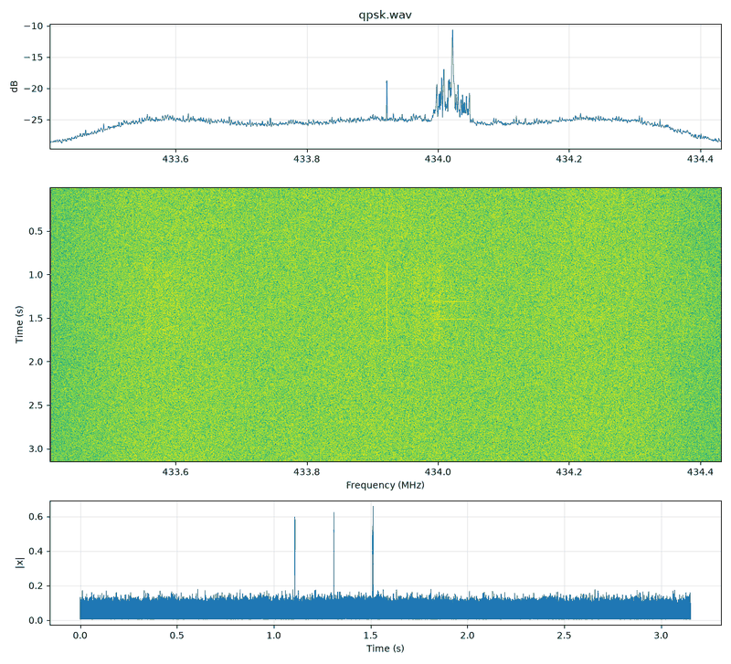

# 05 · Phase and QAM: BPSK, QPSK, 8PSK, 16/64-QAM

Linear modulations put each symbol on a point of the complex plane (a **constellation**), then turn that
symbol stream into a smooth waveform with a **pulse-shaping filter**. Amplitude and frequency stay
(mostly) constant for PSK, so the waterfall shows a solid block and AM/FM audio is just noise. That
non-result is itself the clue.

## Constellations (Gray-mapped, unit average power)

```python
from rfkit import mod
mod.constellation("bpsk")    # [+1, -1]
mod.constellation("qpsk")    # (±1 ± j)/√2, Gray: neighbours differ by one bit
mod.constellation("8psk")    # 8 points on the unit circle, Gray
mod.constellation("16qam")   # 4×4 grid, Gray per axis
```

| Scheme | bits/symbol | Needs SNR for ~1e-5 BER (approx., Eb/N0) |
|---|---|---|
| BPSK | 1 | 9.6 dB |
| QPSK | 2 | 9.6 dB (same Eb/N0, twice the data) |
| 8PSK | 3 | ~13 dB |
| 16QAM | 4 | ~13.5 dB |
| 64QAM | 6 | ~18 dB |

## Pulse shaping: root-raised cosine (RRC)

Rectangular symbols (`np.repeat`) have a sinc spectrum that never ends. Production systems send each symbol
as an RRC pulse instead. The receiver applies the same RRC (a matched filter), and the cascade is a
raised-cosine pulse with zero intersymbol interference at the sampling instants.

```python
sps = fs // symbol_rate                                   # integer samples per symbol
symbols = mod.constellation("qpsk")[mod.bits_to_symbols(b, 2)]
impulses = mod.upsample(symbols, sps)                     # symbol, then sps-1 zeros
x = np.convolve(impulses, mod.rrc_taps(sps, beta=0.35) * np.sqrt(sps))
# one call: x = mod.linear_mod(b, "qpsk", fs, symbol_rate, beta=0.35)
```

- Occupied bandwidth ≈ **symbol_rate × (1 + β)**. β = 0.35 is a common default, 0.2 tighter, 0.5 easier
  to receive.
- The filter spans ~10 symbols. Each burst grows by that much at both ends.
- PSK with RRC is **not** constant envelope. PAPR is ~3–4 dB for QPSK, so back off for the 8-bit DAC.

```bash
.venv/bin/python signal_generation/generate.py psk --scheme qpsk --rate 50e3 --text "HELLO" --repeat 3 -o qpsk.cs8
.venv/bin/python tools/rx_decode.py psk qpsk.cs8 --fs 2e6 --rate 50e3 --order 4 --plot qpsk
```



## Give the receiver something to lock to

A real receiver must recover carrier frequency, carrier phase and symbol timing before it can read bits:

1. **Long preamble.** `generate.py psk` uses 8 bytes of `0xAA` by default (vs 2 for OOK/FSK) so the Costas
   loop and timing settle before the sync word.
2. **A sync word** resolves the **phase ambiguity**. A PSK receiver can lock 180° (BPSK) or 90°/180°/270°
   (QPSK) off. The decoder tries every rotation and keeps the one where the sync word and CRC check out
   (`rx_decode.py` reports `rotation_deg`). Over the air here, BPSK and QPSK both decoded at 0°, but don't
   count on that.
3. **Or differential encoding** (DBPSK/DQPSK): information is in the phase *change*, so absolute phase
   doesn't matter. Costs ~1–3 dB.

```python
x = mod.linear_mod(b, "bpsk", fs, 50e3, differential=True)
# receiver: bits = rfkit.bits.differential_decode(hard_bits)
```

## How the receiver does it (rfkit.dsp.psk_demod)

```text
coarse CFO: FFT of x^M (M=2 BPSK, 4 QPSK) has a line at M·offset → divide by M
→ derotate → RRC matched filter → choose the sampling phase with the most energy
→ Costas loop (decision-directed) removes residual frequency/phase → slice → resolve ambiguity with sync
```

Measured over the air at 50 kBd with HackRF gain 20: in-band SNR ~16–18 dB, BPSK and QPSK both 3/3 packets
with CRC OK.

## Variants worth knowing

| Variant | Idea | Where |
|---|---|---|
| π/4-QPSK | Rotate the constellation 45° every symbol: never passes through zero | TETRA, NADC |
| OQPSK | Delay Q by half a symbol: smaller envelope dips | Zigbee (802.15.4 O-QPSK) |
| APSK | Rings of points | DVB-S2 |
| CPM / GMSK | Continuous phase (see guide 04) | GSM, BLE |
