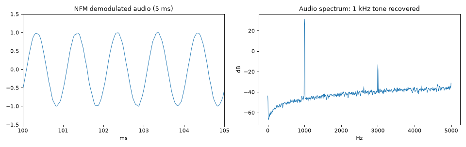

# 06 · Analog modulation: AM, FM, SSB

Analog modes carry a continuous message (audio). The recipe is the same as for data, except the "symbols"
are audio samples resampled to the IQ rate.

```python
from rfkit import mod
audio_48k = ...                                    # float array in [-1, 1] at 48 kHz (a WAV, a tone, speech)
a = mod.resample_audio(audio_48k, 48_000, fs)      # up to the IQ sample rate (linear interp is fine here)
```

## AM (double sideband, full carrier)

```python
x = mod.am(a, depth=0.8)                 # (1 + m·a) / (1 + m): envelope = carrier + audio
x = mod.shift(x, 100e3, fs)
```

- Modulation depth *m* ≤ 1, or the envelope goes negative and distorts (over-modulation).
- Bandwidth = 2 × audio bandwidth (10 kHz for 5 kHz audio). Broadcast AM channels are 9/10 kHz, airband
  8.33/25 kHz.
- **DSB-SC** (no carrier): `mod.dsb_sc(a)`. Needs a coherent receiver.

## FM

Instantaneous frequency follows the audio: `f(t) = Δf · a(t)`, so phase = 2π·Δf·∫a.

```python
x = mod.fm(a, deviation_hz=5e3, fs=fs)             # NFM voice
x = mod.fm(a, deviation_hz=75e3, fs=fs)            # broadcast WFM (mono)
```

```bash
.venv/bin/python signal_generation/generate.py fm --audio voice.wav --dev 5e3 -o nfm.cs8
.venv/bin/python signal_generation/generate.py fm --audio-tone 1000 --dev 5e3 --seconds 2 -o nfm_tone.cs8
.venv/bin/python tools/rx_decode.py fm --nfm nfm_tone.cs8 --fs 2e6 --out audio.wav   # dominant 1000 Hz
```

| Use | Peak deviation | Audio BW | Carson bandwidth 2(Δf + fm) |
|---|---|---|---|
| NFM 12.5 kHz channel (PMR, LMR) | 2.5 kHz | 3 kHz | 11 kHz |
| NFM 25 kHz channel (amateur, FRS) | 5 kHz | 3 kHz | 16 kHz |
| Broadcast WFM | 75 kHz | 15 kHz (+ stereo/RDS subcarriers to 57 kHz+) | ~200 kHz |

**Pre-/de-emphasis.** Broadcast FM boosts treble before modulating (75 µs in the Americas and Korea, 50 µs
elsewhere) and the receiver cuts it back, which reduces hiss. To sound right in SDR++'s WFM mode,
pre-emphasise generated audio with a first-order high-shelf (or accept slightly dull audio). NFM voice
usually skips it.

**Stereo broadcast FM** (for completeness): the composite signal is `L+R` (0–15 kHz) + 19 kHz pilot +
`(L−R)` DSB-SC on 38 kHz + RDS at 57 kHz. Build the composite at ≥ 200 kHz, then FM-modulate it at 75 kHz
deviation.

Over the air on this bench: a 1 kHz tone at 5 kHz deviation came back as a 1000.0 Hz dominant audio
frequency after `rx_decode.py fm --nfm`.



*Demodulated audio from the received NFM test: a clean 1 kHz sine, with a 3rd harmonic about 45 dB down.*

## SSB

SSB removes the carrier and one sideband, so the occupied bandwidth equals the audio bandwidth. In complex
baseband it is simply the **analytic signal** of the audio (positive frequencies only for USB):

```python
x = mod.ssb(a, upper=True)        # USB. upper=False -> LSB (the complex conjugate)
```

`mod.ssb` builds the analytic signal with an FFT-domain Hilbert transform. Tune SDR++ to the carrier
position in USB mode to hear it. Being 50 Hz off makes voices sound high or low ("Donald Duck").

## PM (phase modulation)

```python
x = mod.pm(a, index_rad=1.0)
```

PM of `a` is FM of `da/dt`. It's used inside some digital radios and is mostly of academic interest when
generating test signals.

## Audio sources

- WAV files: `generate.py am|fm --audio file.wav` (mono or stereo, 8/16/32-bit; first `--seconds`).
- Tones and two-tone tests: `--audio-tone 1000`, or build in NumPy (`examples/gen_nfm_tone.py`).
- **DTMF, AFSK (Bell 202 1200/2200 Hz APRS), SSTV tones** are just audio. Generate the audio, then FM-modulate
  it. E.g. AFSK1200 = continuous-phase FSK at 1200 Bd with tones 1200/2200 Hz, then `mod.fm(..., 3e3)`.
