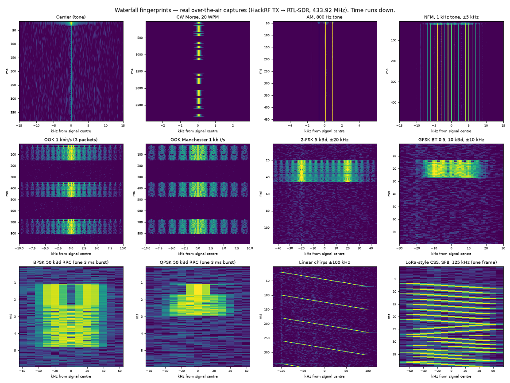

# Signal generation with Python and NumPy

You don't need GNU Radio or a lab signal generator to make real radio signals. A signal is just an array of
complex numbers (IQ samples). Build it with NumPy, save it as bytes, and play it through a HackRF (or a
USRP). This folder teaches that workflow from a single tone up to framed digital packets, PSK/QAM, chirps,
OFDM and pictures in the waterfall. It also gives an agent ready-made tools to do it.

```text
 bits / message ──► symbols ──► samples (np.repeat or pulse shaping) ──► modulate ──► shift to offset
      ──► scale to int8 (.cs8) ──► hackrf_transfer -t ──► RF ──► receiver verifies
```



Everything here was verified twice: in software loopback (`tests/test_loopback.py`, 16 tests) and over the
air, HackRF → RTL-SDR at 433.92 MHz, where every modulation decoded (`tests/ota_test.py`, results in
[12_verifying_over_the_air.md](12_verifying_over_the_air.md)).

Background reading: the Skinny R&D article [Generating Signals With NumPy](https://skinnyrd.com/generating-signals-with-numpy/)
covers tone → Morse → OOK → 2-FSK with real captures. These guides extend the same recipe.

## Walkthroughs

| # | Guide | You will build |
|---|---|---|
| 01 | [IQ fundamentals](01_iq_fundamentals.md) | What an IQ sample is, positive/negative frequency, sample rate, CS8 and other file formats |
| 02 | [Tones and frequency placement](02_tones_and_placement.md) | Carriers, offsets, multi-tone, avoiding DC, frequency resolution |
| 03 | [Amplitude: Morse, OOK, ASK](03_amplitude_keying.md) | CW with shaped keying, OOK packets, PWM remotes, multi-level ASK |
| 04 | [Frequency: FSK, GFSK, MSK, 4-FSK](04_frequency_keying.md) | Continuous-phase FSK, Gaussian shaping, modulation index |
| 05 | [Phase: BPSK, QPSK, 8PSK, QAM](05_phase_and_qam.md) | Constellations, RRC pulse shaping, differential coding |
| 06 | [Analog: AM, FM, SSB](06_analog_modulation.md) | Audio → AM/FM/SSB, deviation, pre-emphasis |
| 07 | [Framing, line codes, CRC](07_framing_and_coding.md) | Preamble/sync/length/CRC, Manchester, NRZI, whitening |
| 08 | [Chirps, spread spectrum, OFDM](08_chirps_spread_ofdm.md) | Linear chirps, LoRa-style CSS, DSSS/Barker, toy OFDM |
| 09 | [Waterfall art](09_waterfall_art.md) | Text and images that appear in an SDR waterfall |
| 10 | [Noise and impairments](10_noise_and_impairments.md) | AWGN at a given SNR, CFO, phase, IQ imbalance, clipping, test signals for decoders |
| 11 | [Transmitting](11_transmitting.md) | HackRF and USRP playback, gain, headroom, repeating, streaming |
| 12 | [Verifying over the air](12_verifying_over_the_air.md) | Closed-loop TX → SDR++/RTL-SDR → decode, and the measured results |

## Tools

| Path | What |
|---|---|
| [`generate.py`](generate.py) | CLI: `tone`, `morse`, `ook`, `fsk` (2/4-level, GFSK), `psk` (BPSK/QPSK/8PSK/16QAM/64QAM), `am`, `fm`, `chirp`, `css`, `text`, `noise` → `.cs8/.cu8/.cs16/.cf32/.wav/.sigmf` |
| [`examples/`](examples/) | Standalone NumPy-only scripts (no repo imports): `gen_tone.py`, `gen_morse.py`, `gen_ook.py`, `gen_2fsk.py`, `gen_bpsk.py`, `gen_nfm_tone.py` |
| [`../rfkit/`](../rfkit/) | The library behind it: `iq` (file I/O), `bits` (framing/CRC/line codes), `mod` (modulators), `dsp` (receivers), `plot` |
| [`../tools/rx_decode.py`](../tools/rx_decode.py) | Decoder for everything `generate.py` makes (Morse, OOK, Manchester OOK, FSK/GFSK, BPSK/QPSK, NFM/WFM audio) |
| [`../radios/hackrf/tools/hackrf_tx.py`](../radios/hackrf/tools/hackrf_tx.py) | TX helper (duration readout, N replays with gaps, dry run) |

## Quick start

```bash
python3 -m venv .venv && .venv/bin/pip install -r requirements.txt
P=.venv/bin/python

$P signal_generation/generate.py fsk --text "HELLO" --rate 5000 --dev 20e3 --repeat 3 --plot -o tmp/fsk.cs8
$P tools/rx_decode.py fsk tmp/fsk.cs8 --fs 2e6                      # decode the file itself (loopback)
$P radios/hackrf/tools/hackrf_tx.py tmp/fsk.cs8 --freq 433.92e6 --rate 2e6 --gain 20
```

Every `generate.py` run prints the file's duration, PAPR and 99 % occupied bandwidth, plus the matching
`hackrf_transfer` command. `--plot` writes a PSD/waterfall/magnitude PNG next to the file.

## Five things that matter for clean signals

1. **The sample rate is part of the signal.** Generate at the rate you'll transmit (`-s`). The HackRF
   needs ≥ 2 MS/s. Make the rate an integer multiple of the symbol rate (rfkit refuses otherwise).
2. **Build at 0 Hz, then shift.** Multiply by `exp(j·2π·f·t)` to place the signal +50–200 kHz from the
   centre, away from DC/LO leakage.
3. **No instant jumps.** Shape amplitude edges (raised cosine) and keep phase continuous (`cumsum` for
   FSK, RRC pulses for PSK). Jumps splatter energy across the band.
4. **Leave headroom.** Scale to ~80 % of full scale before converting to 8-bit. Peaky signals (OFDM,
   multitone, QAM) need more back-off.
5. **Frame it.** Real receivers need a preamble (timing), a sync word (alignment) and a CRC (proof). Send
   packets more than once.
