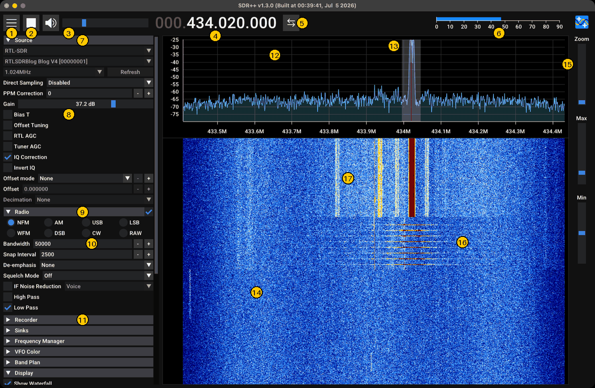
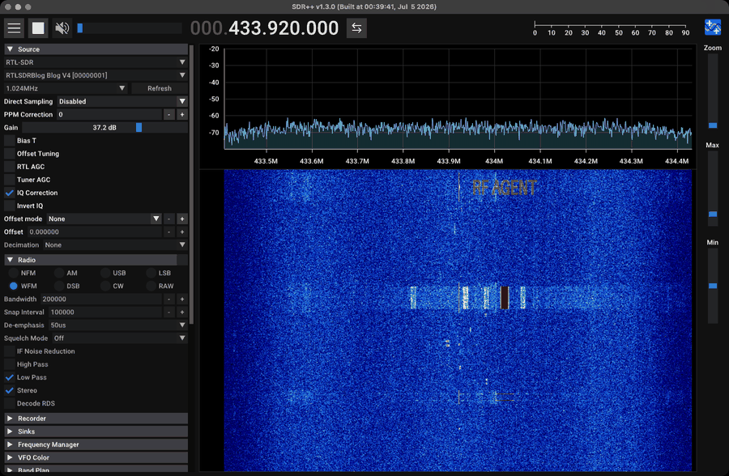

# SDR++

[SDR++](https://github.com/AlexandreRouma/SDRPlusPlus) is a fast, cross-platform SDR receiver: a GPU
waterfall, demodulators (NFM/WFM/AM/DSB/USB/LSB/CW/RAW), a baseband/audio recorder, and a module system
(sources, sinks, decoders, a **rigctl server** for remote control). On this bench it is the main receive
GUI. An agent drives it without a mouse through config files + rigctl + screenshots.

> Verified on this bench (2026-10-14): **SDR++ v1.3.0** macOS build ("Built at 00:39:41, Jul 5 2026";
> `Info.plist` says 1.2.1, the window title says 1.3.0), with the RTL-SDR Blog V4 and HackRF One as
> sources. Everything in [rigctl.md](rigctl.md) was exercised live.

| Doc | Contents |
|---|---|
| this page | Install, UI tour, sources, display, demodulators, recorder, config files, CLI flags, server mode |
| [rigctl.md](rigctl.md) | Remote control: rigctl server/client, every command (verified), recording automation, screenshots, gotchas |
| [tools/](tools/) | `sdrpp.py` (Python control module), `sdrppctl.py` (CLI), `winlist.swift` (window ID for screenshots) |

---

## 1. Install

| OS | How |
|---|---|
| macOS | Download the nightly `sdrpp_macos_*.zip` from GitHub releases → drag `SDR++.app` to `/Applications`. First launch: right-click → Open (unsigned) |
| Windows | Nightly `sdrpp_windows_x64.zip`, run `sdrpp.exe` |
| Debian/Ubuntu | Nightly `.deb` for your release: `sudo apt install ./sdrpp_*.deb` |
| Source | `cmake .. -DOPT_BUILD_RIGCTL_SERVER=ON -DOPT_BUILD_USRP_SOURCE=ON ...` (each module has an `OPT_BUILD_*` switch) |

Modules shipped in this macOS build (`/Applications/SDR++.app/Contents/Plugins`): sources for Airspy,
AirspyHF, BladeRF, FobosSDR, **HackRF**, Hermes, HydraSDR, LimeSDR, PlutoSDR, RFNM, RFspace,
**RTL-SDR**, **RTL-TCP**, SDRplay, **SDR++ Server**, SpyServer, File, Network; plus `radio`, `recorder`,
`frequency_manager`, `scanner`, `meteor_demodulator`, `atv_decoder`, `network_sink`, audio sinks,
**`rigctl_server`**, **`rigctl_client`**, `discord_integration`. **No USRP/UHD source on macOS**. Use GNU
Radio or SDRangel for the B210 there.

---

## 2. UI tour (what each control maps to)



*Real screenshot from this bench: RTL-SDR at 433.92 MHz, 1.024 MS/s, gain 37.2 dB; VFO in NFM on a HackRF
test transmission at +100 kHz. FSK packets sent first have scrolled down the waterfall; the NFM carrier is
on now.*

| # | Element | # | Element |
|---|---|---|---|
| 1 | Menu (show/hide side panel) | 10 | Demod bandwidth |
| 2 | Start/stop source | 11 | Recorder (collapsed) |
| 3 | Audio mute + volume | 12 | Spectrum (FFT) with dB scale |
| 4 | Frequency display (VFO, or centre with no VFO) | 13 | VFO: grey band = demod bandwidth, red line = tuned frequency |
| 5 | Tuning mode (centre follows VFO / free VFO) | 14 | Waterfall: newest line at the top |
| 6 | SNR meter for the VFO | 15 | Zoom, Max and Min (dB display range) sliders |
| 7 | Source panel: device, rate, PPM, gain, AGCs, IQ options | 16 | FSK packets from earlier, scrolling down |
| 8 | RTL gain (37.2 dB = index 20) | 17 | Spurs appearing only while the strong carrier is on: overload/TX products. Lower RX gain or TX power and they drop |
| 9 | Radio panel: demod mode | | |

Schematic of the same layout:

```text
┌ ☰ ■/▶ 🔊 volume   000.433.920.000  ⇆                      SNR meter ───────────────┐
│ Source ▾          │  FFT / spectrum  (dB vs frequency)                      Zoom  │
│ Radio ▾           │──────────────────────────────────────────────────────── Max   │
│ Recorder ▾        │  Waterfall (time runs DOWN, newest line at the top)      Min   │
│ Sinks ▾           │                                                              │
│ Frequency Manager │                                                              │
│ Rigctl Server ▾   │                                                              │
│ Display ▾ ...     │                                                              │
└───────────────────┴──────────────────────────────────────────────────────────────┘
```

| Control | Effect | Config key |
|---|---|---|
| ☰ | Show/hide the side menu | `config.json: showMenu` |
| ■ / ▶ | Stop/start the source | rigctl `\stop` / `\start`; `--autostart` CLI flag |
| Frequency digits | Click the upper/lower half of a digit (or scroll) to change it. Typing a number + Enter also works | `config.json: frequency` (centre), `vfoOffsets` |
| ⇆ | Tuning mode: centre follows the VFO vs. the VFO moves inside a fixed span | `centerTuning` |
| Spectrum/waterfall | Click to place the VFO, drag to retune | |
| Zoom / Max / Min sliders | Horizontal zoom, top and bottom of the dB range | `min`, `max` |
| Source panel | Device, sample rate, gains, PPM, bias-T, AGCs, direct sampling, offset tuning, **IQ correction**, **Invert IQ**, offset mode, **Decimation** | `<source>_config.json`, `config.json: decimation, iqCorrection, invertIQ, offsets` |
| Radio panel | Demod mode, bandwidth, snap interval, de-emphasis, squelch, noise blanker, IF noise reduction, stereo, RDS | `radio_config.json` per mode |
| Recorder | Baseband or audio, path, name template, container, sample type | `recorder_config.json` |
| Display (menu) | FFT size, FFT rate, window, colour map, full waterfall update, FFT hold/smoothing, SNR smoothing, band plan | `fftSize, fftRate, fftWindow, colorMap, fftHold, fftSmoothing, ...` |

---

## 3. Sources

### RTL-SDR (`rtl_sdr_config.json`)

```json
{
  "device": "RTLSDRBlog Blog V4 [00000001]##0",
  "devices": {
    "RTLSDRBlog Blog V4 [00000001]##0": {
      "sampleRate": 2560000.0, "gain": 15, "ppm": 0,
      "biasT": false, "directSampling": 0, "offsetTuning": false, "rtlAgc": false, "tunerAgc": false
    }
  }
}
```

- `gain` is an **index** into the tuner's gain table (0–28 for R820T/R828D; 20 = 37.2 dB, 28 = 49.6 dB).
  See [../../radios/rtl-sdr/README.md](../../radios/rtl-sdr/README.md).
- The sample-rate menu runs from 250 kS/s to 3.2 MS/s (1.024M and 2.048M are the usual choices; this
  bench's config used 2.56M). Stay ≤ 2.4–2.56 MS/s to avoid dropped samples.
- `rtlAgc`/`tunerAgc` must be **false** for decoding and measurement.
- The device key includes the serial. Give each dongle a unique serial (`rtl_eeprom -s`) when several are
  attached.

### HackRF (`hackrf_config.json`)

```json
{ "device": "0000000000000000xxxxxxxxxxxxxxxx",
  "devices": { "0000000000000000xxxxxxxxxxxxxxxx": {
      "sampleRate": 4000000, "lnaGain": 24, "vgaGain": 24, "amp": false, "biasT": false, "bandwidth": 16 } } }
```

`bandwidth` is an index into the baseband-filter list. **16 = Auto** (follows the sample rate). Index 0 is
the narrow 1.75 MHz filter, a common surprise. Verified here at 8 MS/s on the FM band.

**A HackRF used as an SDR++ source cannot transmit at the same time.** For TX tests, SDR++ must use the
RTL-SDR, and the HackRF stays free for `hackrf_transfer`.

### Other source modules worth knowing

| Source | Use |
|---|---|
| **File Source** | Play back a baseband WAV (SDR++ recordings) as if live. Great for re-demodulating a capture by ear |
| **RTL-TCP** | Remote dongle running `rtl_tcp` |
| **SDR++ Server** | Remote SDR++ in server mode (§8), with compression |
| **SpyServer** | Airspy / RTL SpyServer instances |
| **Network** | Raw IQ over TCP/UDP |

---

## 4. Display settings that matter for analysis (and for screenshots)

| Setting | Guidance |
|---|---|
| FFT size | 8192 is a good default at 1–2.4 MS/s (≈125–300 Hz bins). 32768–65536 for narrow CW/FSK detail |
| FFT rate | Waterfall lines per second. 30 = slow scroll; 200–1000 shows short packets. FFT size × rate above ~50 M bins/s drops lines (measured on this Mac), so the time axis becomes irregular |
| Min/Max | Put Min just under the noise floor and Max ~40–60 dB above it. With RTL gain index 20 at 433 MHz the floor shows near −70 dB, so −80/−30 works. At 900 MHz use −100/−50 |
| Colour map | "Classic" (default) is fine. Keep it the same across a dataset |
| Decimation | Zooms the *processed* span (the source still runs at full rate). Disable the Radio VFO when decimating heavily, or SDR++ can segfault when the VFO is wider than the span |
| Show menu | Hide it (`showMenu=false`) for bigger waterfall screenshots |

The waterfall **scrolls downward with the newest line at the top**. Anything drawn into the waterfall
(see [../../signal_generation/09_waterfall_art.md](../../signal_generation/09_waterfall_art.md)) must send
its bottom row first to appear upright.



*Above: `generate.py text --text "RF AGENT"` transmitted by the HackRF at 433.92 MHz + 100 kHz, received
by the RTL-SDR in SDR++ (1.024 MS/s, FFT 8192 @ 30 fps). Captured by `tests/ota_test.py`.*

---

## 5. Demodulators (Radio module)

| Mode | Default BW | Use |
|---|---|---|
| NFM | 12.5 kHz | Two-way radio, PMR/FRS, APRS, pagers (listen), 2-FSK by ear |
| WFM | 200 kHz | Broadcast FM. Options: stereo, RDS decode, de-emphasis 50 µs (EU) / 75 µs (US) |
| AM | 10 kHz | Airband, broadcast AM, OOK by ear (beeps) |
| DSB | 4.6 kHz | Double sideband |
| USB / LSB | 2.8 kHz | SSB voice (amateur), digital modes (FT8/RTTY audio) |
| CW | 500 Hz | Morse. Narrow the filter to ~200 Hz on weak signals |
| RAW | — | Outputs the IQ as stereo audio (I = left, Q = right). Handy to pipe narrowband IQ elsewhere |

Each mode keeps its own settings in `radio_config.json` (bandwidth, squelch, noise blanker,
de-emphasis...). Over rigctl: `M <mode> <bw>` once a VFO is selected for rigctl. Use Hamlib names: `M FM 12500`
selects SDR++'s NFM (`M NFM` is rejected with `RPRT 1`).

---

## 6. Recorder

The Recorder module writes either **baseband IQ** (`mode: 0`) or **demodulated audio** (`mode: 1`) as WAV.

```json
{ "Recorder": { "mode": 0, "recPath": "/path/to/rec", "nameTemplate": "$t_$f_$h-$m-$s_$d-$M-$y",
                "container": "WAV", "sampleType": "INT16", "ignoreSilence": false, "stereo": true } }
```

- Baseband files: `baseband_<centreHz>Hz_<hh-mm-ss>_<dd-mm-yyyy>.wav`. RIFF WAV, **2 channels (I, Q), int16**,
  at the source sample rate. `rfkit.iq.load()` reads them and picks up the rate; `iq.info_from_name()`
  parses the centre frequency.
- Size: 4 bytes/sample → **4.1 MB/s at 1.024 MS/s, 8.2 MB/s at 2.048 MS/s** (measured: 3 s → 24.6 MB).
- Template variables (default `$t_$f_$h-$m-$s_$d-$M-$y`): `$t` type (baseband/audio), `$f` frequency,
  `$h $m $s` time, `$d $M $y` date.
- `container`/`sampleType` are **strings** in current SDR++. An integer value there makes SDR++ **abort at
  launch** (C++ JSON type error). macOS then shows "SDR++ quit unexpectedly while reopening windows" and
  blocks later launches until someone clicks *Don't Reopen*. Leave those keys out to get WAV/INT16.
- Audio mode records the Radio VFO output and needs the Radio module enabled.
- The recorder fixes up the WAV header when it stops. A killed SDR++ leaves a header with a bogus length.
  `rfkit.iq.load` trusts the file size in that case.

Start/stop: the Record button, or rigctl `\recorder_start` / `\recorder_stop` (`AOS` / `LOS`) once the
rigctl server is linked to the recorder ([rigctl.md](rigctl.md) §3).

---

## 7. Config files

All in `~/Library/Application Support/sdrpp/` (macOS), `~/.config/sdrpp/` (Linux), `%AppData%/sdrpp`
(Windows), or the directory given with `-r`.

| File | What's in it |
|---|---|
| `config.json` | Centre `frequency`, `source`, display (`fftSize`, `fftRate`, `fftWindow`, `min`, `max`, `colorMap`, `decimation`, `showMenu`, `showWaterfall`, `fftHeight`, `maximized`), `moduleInstances` (which modules are enabled), `vfoOffsets`, `offsets` (upconverter presets), `menuElements` (order/open state), `streams` (audio sink + volume), `iqCorrection`, `invertIQ`, `theme`, `uiScale` |
| `<source>_config.json` | Per-device source settings (`rtl_sdr_config.json`, `hackrf_config.json`, ...) |
| `radio_config.json` | Demodulator settings per mode |
| `recorder_config.json` | Recorder settings |
| `rigctl_server_config.json` | `host`, `port`, `autoStart`, `tuning`, `recording`, `recorder`, `vfo` |
| `rigctl_client_config.json` | `host`, `port`, `ifFreq` |
| `frequency_manager_config.json` | Bookmark lists |
| `recordings/` | Default recording folder |

**SDR++ reads these at startup and rewrites them on exit.** Edit them only while SDR++ is closed, or your
edit is lost. That's why automation is quit → edit → relaunch. `tools/sdrpp.py` handles it.

---

## 8. Command line, isolated configs, server mode

```text
sdrpp [-r <root dir>] [--autostart] [-s|--server] [-a <addr>] [-p <port>] [-h]
  -r, --root       directory holding all config files (default: the OS location above)
      --autostart  start the source immediately after loading
  -s, --server     headless server mode: other SDR++ instances connect with the "SDR++ Server" source
  -a, --addr / -p  server listen address / port (default 0.0.0.0:5259)
```

On macOS pass arguments through `open`:

```bash
open -a SDR++ --args -r "$PWD/tmp/sdrpp/root" --autostart    # private config directory (verified)
/Applications/SDR++.app/Contents/MacOS/sdrpp -s -p 5259        # headless server
```

**Isolated configs are how this repo automates SDR++ safely.** `tools/sdrpp.py` copies your config once
into `tmp/sdrpp/root/` and always launches with `-r` that directory, so your own SDR++ settings are never
modified (verified: md5 of the user's `config.json` unchanged after a full capture run). Set
`SDRPP_ISOLATED=0` to drive the normal config instead (then use `sdrppctl.py backup` / `restore`).

Server mode lets an agent run SDR++ headless next to the radio while a GUI instance elsewhere watches. The
client picks "SDR++ Server", enters host:port, and can choose sample type/compression to save bandwidth.

---

## 9. Driving SDR++ from the command line (this repo's tools)

```bash
P=.venv/bin/python; T=software/sdr++/tools/sdrppctl.py
$P $T setup --freq 433.92e6 --rate 1.024e6 --gain 20            # RTL-SDR profile, launch, start
$P $T setup --source HackRF --freq 98e6 --rate 8e6 --lna 24 --vga 20
$P $T setup --freq 98.1e6 --rate 2.048e6 --radio                 # keep the Radio VFO (for M / audio)
$P $T status                                                      # running? rigctl? freq/mode/config dir
$P $T tune 433.95e6                                               # F <hz>
$P $T rig "M FM 12500"                                            # any rigctl command (FM = NFM)
$P $T record 5 --out tmp/sdrpp/caps/test.wav                      # baseband WAV
$P $T shot tmp/sdrpp/shots/now.png                                # window screenshot
$P $T analyze tmp/sdrpp/caps/test.wav --png tmp/sdrpp/caps/test.png
$P $T capture demo --freq 433.92e6 --seconds 6 --shots 2 --analyze -- \
      $P radios/hackrf/tools/hackrf_tx.py sig.cs8 --freq 433.92e6 --rate 2e6 --gain 20
$P $T user                                                        # close automation SDR++, reopen yours
```

`capture` = profile → launch → `\recorder_start` → run the TX command (if any) → screenshots during it →
`\recorder_stop` → move the WAV to `tmp/sdrpp/caps/NAME.wav` → optional analysis (carriers with absolute
frequency, SNR, bursts, overview PNG). Everything lands in `tmp/`.

Details, protocol and gotchas: [rigctl.md](rigctl.md).

---

## 10. Troubleshooting

| Symptom | Fix |
|---|---|
| SDR++ won't start after a config edit | Bad JSON or wrong value types (see Recorder gotcha). Check `~/Library/Logs/DiagnosticReports/sdrpp-*.ips`. Click *Don't Reopen* on the macOS dialog |
| Source won't start ("device busy") | Another program has the radio (`pgrep -lf "rtl_|hackrf_|gqrx"`) |
| No audio | Audio sink/device in Sinks; volume; mute icon; squelch too high |
| Waterfall too dark/bright | Adjust the Max/Min sliders (or `min`/`max` in `config.json`) |
| Crashes when changing decimation | Disable the Radio VFO, or reduce its bandwidth below the decimated span |
| Settings revert | You edited JSON while SDR++ was running. Quit first |
| Screenshot fails | Grant **Screen Recording** permission to the terminal/app running the script. Keep the display awake (`caffeinate -dims`) |
