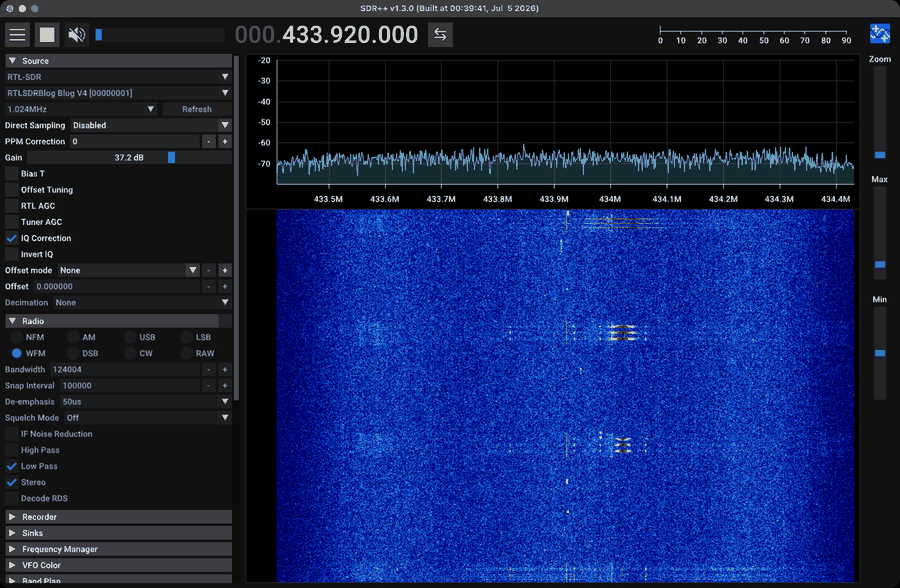

# Controlling SDR++ with rigctl (and capturing signals + waterfall images)

SDR++ ships two modules that speak the **Hamlib rigctld TCP protocol**:

- **Rigctl Server** (`rigctl_server`): SDR++ *is* the rig. Any rigctl client (a Python socket, `nc`,
  Hamlib's `rigctl -m 2`, Gpredict, WSJT-X, logging software) can tune it, set the demod mode,
  start/stop the source and start/stop the **Recorder**. This is how an agent drives SDR++.
- **Rigctl Client** (`rigctl_client`): SDR++ *follows* an external rig. It pushes its tuned frequency to
  a `rigctld` (e.g. a real transceiver) with an optional IF offset, for panadapter setups.

Everything below was run against SDR++ v1.3.0 on macOS with an RTL-SDR Blog V4 (2026-10-14) unless marked
otherwise.

---

## 1. Enable the server

GUI: menu → **Rigctl Server** → host `localhost`, port `4532`, tick **Tuning**, tick **Recording** and
pick the recorder ("Recorder"), choose the controlled VFO ("Radio" or none), **Start**. Tick
**Listen on startup** to make it permanent.

Config (`rigctl_server_config.json`, edit only while SDR++ is closed):

```json
{
    "Rigctl Server": {
        "autoStart": true,
        "host": "localhost",
        "port": 4532,
        "tuning": true,
        "recording": true,
        "recorder": "Recorder",
        "vfo": ""
    }
}
```

| Key | Meaning |
|---|---|
| `autoStart` | Start listening when SDR++ launches. **Required for headless automation** |
| `host` / `port` | Bind address. Keep `localhost` unless you mean to expose it (no authentication) |
| `tuning` | Allow `F` to change frequency |
| `recording` | Allow `\recorder_start` / `\recorder_stop` to control a recorder. **If false, those commands reply `RPRT 0` and do nothing** |
| `recorder` | Name of the recorder instance to control (`"Recorder"` by default). Empty = nothing happens |
| `vfo` | Radio VFO instance controlled by `F`/`M` (`"Radio"`), or `""` for none. With none, `F` tunes the **centre frequency** and `M` fails |

The module instance must also be enabled in `config.json` → `moduleInstances["Rigctl Server"].enabled`.

---

## 2. Protocol basics

Plain text over TCP, one command per line, Hamlib style:

- **set** commands reply `RPRT 0` (OK) or `RPRT <n>` (error; `RPRT 1` was returned for an invalid mode).
- **get** commands reply with the value(s), one per line, and no `RPRT`.
- Short (`F`) and long (`\set_freq`) forms are equivalent. Several commands can share one connection.

```bash
printf 'f\nm\nv\n' | nc -w 2 localhost 4532
# 440000000
# WFM
# 124004
# VFO
```

```python
import socket
def rig(cmd, host="localhost", port=4532):
    with socket.create_connection((host, port), timeout=3) as s:
        s.sendall((cmd + "\n").encode())
        return s.recv(4096).decode().strip()

rig("F 433920000")        # 'RPRT 0'
rig("f")                  # '433920000'
rig("\\recorder_start")   # 'RPRT 0'   (note the escaped backslash in Python)
```

Hamlib's own client should work through its network backend (model 2). Not tested here because Hamlib
isn't installed: `rigctl -m 2 -r localhost:4532 F 433920000`.

---

## 3. Command reference (verified)

| Command (short / long) | Reply | Behaviour observed |
|---|---|---|
| `F <hz>` / `\set_freq <hz>` | `RPRT 0` | **With a VFO selected:** moves that VFO. If it leaves the visible span, SDR++ retunes the centre so the VFO is back in view (tested: VFO 433.95 → 440 MHz with a 1.024 MHz span). **With no VFO (`vfo: ""`):** sets the centre frequency directly |
| `f` / `\get_freq` | `433920000` | VFO frequency (VFO mode) or centre frequency (no VFO) |
| `M <mode> <bw>` / `\set_mode` | `RPRT 0` / `RPRT 1` | Hamlib mode names: **`FM` (= SDR++ NFM)**, `WFM`, `AM`, `DSB`, `USB`, `LSB`, `CW`, `RAW`; `bw` in Hz (`0` = keep). Needs a VFO. Tested: `M FM 12500`, `M WFM 200000` OK; **`M NFM ...` → `RPRT 1`** (not a Hamlib name); `M BOGUS 0` → `RPRT 1`; with no VFO → `RPRT 1`. `M FM 60000` set 50 kHz (FM bandwidth is clamped) |
| `m` / `\get_mode` | `WFM` + `200000` | Mode and bandwidth. With no VFO: `RAW` + `0` |
| `v` / `\get_vfo` | `VFO` | Fixed name |
| `V <vfo>` / `\set_vfo` | `RPRT 0` | Accepted, no effect (single VFO) |
| `\chk_vfo` | `CHKVFO 0` | Hamlib compatibility |
| `\dump_state` | multi-line | Hamlib capability dump (clients call this on connect) |
| `\get_powerstat` | `1` | Always on |
| `\start` / `\stop` | (empty) | Start/stop the source, same as the ▶/■ button |
| `\recorder_start` / `AOS` | `RPRT 0` | Start the linked Recorder (needs `recording: true` and `recorder` set) |
| `\recorder_stop` / `LOS` | `RPRT 0` | Stop it. The file is finalised about 0.5–1 s later |
| `q` / `\quit` | (closes) | Close this connection (SDR++ keeps running) |

`AOS`/`LOS` (acquisition/loss of signal) exist so satellite trackers like Gpredict can start and stop
recordings automatically as a satellite rises and sets.

---

## 4. Capturing signals (the automation pattern)

SDR++ reads source and display settings **only at launch** and **rewrites its config on exit**. A full
capture is therefore:

```text
quit SDR++ → write profile JSON (source, rate, gain, freq, display, recorder path, rigctl) → launch
→ wait for :4532 → \start → F <hz> → \recorder_start → (signal happens / TX runs) → screenshots
→ \recorder_stop → wait ~1 s → newest WAV in recPath is the capture
```

`tools/sdrpp.py` implements it. `tools/sdrppctl.py` is the CLI:

```bash
P=.venv/bin/python; T=software/sdr++/tools/sdrppctl.py
# Set up once and record repeatedly
$P $T setup --freq 433.92e6 --rate 1.024e6 --gain 20
$P $T record 5 --out tmp/sdrpp/caps/survey_433.wav
$P $T tune 434.5e6 && $P $T record 5 --out tmp/sdrpp/caps/survey_434.wav

# One-shot: profile + record + screenshots + run a transmitter + analyse (verified end to end)
$P signal_generation/generate.py fsk --text "SDRPP CAPTURE" --rate 5000 --dev 20e3 --repeat 3 -o tmp/gen/cap_fsk.cs8
$P $T capture fsk_cli --freq 433.92e6 --seconds 4 --shots 1 --analyze -- \
   $P radios/hackrf/tools/hackrf_tx.py tmp/gen/cap_fsk.cs8 --freq 433.92e6 --rate 2e6 --gain 20 --occupied-bw 400e3
$P tools/rx_decode.py fsk tmp/sdrpp/caps/fsk_cli.wav       # -> 3 x "SDRPP CAPTURE", crc_ok true
```

Output of that capture run:

```text
tuned: 433920000
recorder_start: RPRT 0
shot: .../tmp/sdrpp/shots/fsk_cli_0.png
tx exit 0 after 2.3s
recorder_stop: RPRT 0
capture: .../tmp/sdrpp/caps/fsk_cli.wav (17.8 MB)
```

In Python:

```python
import sys; sys.path.insert(0, "software/sdr++/tools"); import sdrpp
sdrpp.restart_with(dict(source="RTL-SDR", freq=433.92e6, sample_rate=1_024_000, gain=20,
                        min_db=-80, max_db=-30, fft_size=8192, fft_rate=30))
sdrpp.tune(433_920_000)
wav = sdrpp.record(5.0, dest="tmp/sdrpp/caps/cap.wav")    # rec_start, sleep, rec_stop, find the file
png = sdrpp.grab("tmp/sdrpp/shots/cap.png")               # waterfall screenshot
```

### Isolated config root (default): never touch the user's settings

`sdrpp.py` launches SDR++ as `open -a SDR++ --args -r <repo>/tmp/sdrpp/root`, a private config directory
seeded once from the user's config. Profiles are written there. Verified: the user's
`config.json`, `rtl_sdr_config.json` and `rigctl_server_config.json` had identical md5 hashes before and
after a full capture. `sdrppctl.py user` closes the automation instance and reopens SDR++ normally.

`SDRPP_ISOLATED=0` switches to editing the real config. Then run `sdrppctl.py backup` first and
`sdrppctl.py restore` after (the backup is written once and never overwritten unless `--overwrite`).

### Profile keys written by `apply_profile()`

| File | Keys |
|---|---|
| `config.json` | `source`, `frequency`, `fftSize`, `fftRate`, `colorMap`, `min`, `max`, `showMenu`, `showWaterfall`, `fftHeight`, `fftHold=false`, `fftSmoothing=false`, `centerTuning=false`, `bandPlanEnabled=false`, `decimation`, `maximized`, `moduleInstances.{Radio,Recorder,Rigctl Server}.enabled`, `vfoOffsets={}` when the Radio is off |
| `rtl_sdr_config.json` | `devices[device].{sampleRate, gain (index), ppm, rtlAgc=false, tunerAgc=false, biasT, offsetTuning=false, directSampling}` |
| `hackrf_config.json` | `devices[serial].{sampleRate, lnaGain, vgaGain, amp=false, biasT=false, bandwidth=16 (Auto)}` |
| `recorder_config.json` | `Recorder.{mode (0 baseband / 1 audio), recPath, nameTemplate}`. Removes non-string `container`/`sampleType` |
| `rigctl_server_config.json` | `autoStart=true, host=localhost, port, recorder="Recorder", recording=true, tuning=true, vfo=("Radio" or "")` |

By default the **Radio module is disabled** for baseband capture. Without a VFO, `F` tunes the centre
(what you want for IQ capture), the VFO overlay stays out of screenshots, and SDR++ can't hit the
decimation/VFO-width segfault. Pass `radio=True` (`--radio`) when you need demodulated audio or `M`.

---

## 5. Signal images (waterfall screenshots)

macOS `screencapture -l <windowID>` grabs one window, even if it's partly covered. The window ID comes
from CoreGraphics. `tools/winlist.swift` prints the largest window owned by a process:

```bash
swiftc -O software/sdr++/tools/winlist.swift -o software/sdr++/tools/winlist   # sdrpp.py does this on first use
software/sdr++/tools/winlist "SDR++"            # -> "<windowID> <x> <y> <w> <h>"
screencapture -x -o -l <windowID> shot.png       # -x no sound, -o no shadow
```

Requirements and tips:

- **Screen Recording permission** for the app running the script (Terminal, iTerm, Claude, VS Code):
  System Settings → Privacy & Security → Screen & System Audio Recording. Without it the capture is blank
  or fails.
- **Keep the display awake** for unattended runs: `caffeinate -dims <command>`. With the display asleep,
  `screencapture -l` exits 1. `sdrpp.grab()` nudges the display (`caffeinate -u`) and retries.
- **Make the waterfall show what you need before grabbing:** set `fft_rate` so the signal's duration
  spans enough lines (lines on screen ≈ duration × FFT rate). Set `min_db`/`max_db` around the noise floor.
  Hide the menu (`show_menu=False`) for a bigger plot.
- Screenshots are for **humans and vision models**. For measurements, analyse the recorded IQ
  (`sdrppctl.py analyze`, `tools/iq_inspect.py`), which gives exact frequency, SNR, bandwidth and timing.
  `rfkit.plot.waterfall()` makes a consistent, labelled waterfall straight from the IQ, without SDR++.
- To crop just the waterfall from a screenshot, find the large colour-mapped region (pixels with high
  colour saturation vs. the grey UI) and crop to it.



---

## 6. Rigctl Client: make SDR++ follow (or drive) another radio

GUI: menu → **Rigctl Client** → host/port of a `rigctld`, **IF frequency** (0 for a normal rig; your
radio's IF for an IF-tap panadapter) → Start. Config: `rigctl_client_config.json` (`host`, `port`,
`ifFreq`).

```bash
rigctld -m <model> -r /dev/ttyUSB0 -s 38400 -t 4533      # Hamlib daemon for a real transceiver
```

SDR++ then pushes its frequency to the radio, so tuning the waterfall tunes the radio. Not tested here
(no Hamlib or transceiver on this bench).

---

## 7. Gotchas (all hit in practice)

1. **Integer `container`/`sampleType` in `recorder_config.json` makes SDR++ abort at launch.** Use strings
   or omit the keys. macOS then holds later launches behind a "reopen windows?" dialog until someone clicks
   *Don't Reopen*. Crash logs: `~/Library/Logs/DiagnosticReports/sdrpp-*.ips`.
2. **`\recorder_start` replies `RPRT 0` but records nothing** unless `recording: true` **and**
   `recorder: "Recorder"` are set in the rigctl server config.
3. **Edits made while SDR++ runs are lost**, because it rewrites the JSON on exit. Quit (`osascript -e
   'quit app "SDR++"'`), edit, relaunch.
4. **`open -a SDR++ --args ...` only passes arguments to a fresh launch.** Quit any running instance first.
5. **`M` fails (`RPRT 1`) without a VFO**, and `F` then tunes the centre rather than a VFO.
6. **The first second after launch/retune is settling**: AGC-free RTL gain changes, PLL lock, waterfall
   clears. Wait ~1–2 s (`--settle`) before `\recorder_start`, and skip the first 50 ms of a capture when
   analysing (`rx_decode.py` does by default).
7. **Recording size**: int16 IQ = 4 bytes/sample → 4.1 MB/s at 1.024 MS/s. Keep captures short. Delete
   `tmp/sdrpp/caps/*.wav` when done.
8. **Only one program per radio.** While SDR++ has the RTL-SDR, `rtl_sdr`/`rtl_433` fail with
   `usb_claim_interface error -6`.
9. **Display levels depend on band and gain.** RTL gain index 20 at 433 MHz puts the floor near −70 dB
   (−80/−30 works); at 900 MHz use about −100/−50.
10. **Very high FFT size × rate (> ~50 M bins/s on this Mac)** drops waterfall lines, so the time axis
    in screenshots becomes irregular.

---

## 8. Cleanup checklist

```bash
pgrep -lf hackrf_transfer                         # must print nothing
.venv/bin/python software/sdr++/tools/sdrppctl.py user   # close the automation SDR++, reopen the user's
rm -f tmp/sdrpp/caps/*.wav tmp/sdrpp/rec/*.wav    # recordings are large
```
