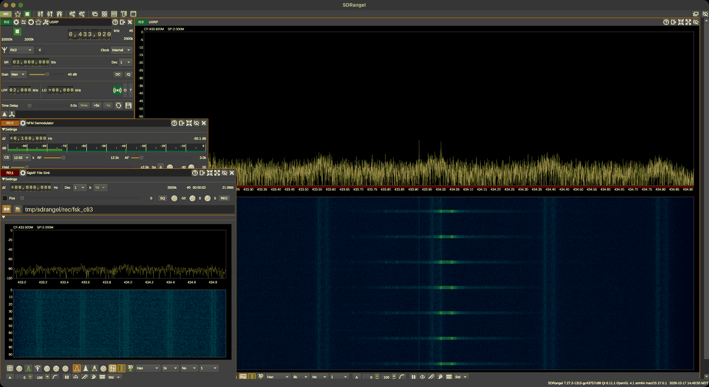

# SDRangel

[SDRangel](https://github.com/f4exb/sdrangel) is a full SDR application for RX **and TX**: many hardware
back-ends (USRP, HackRF, RTL-SDR, PlutoSDR, LimeSDR, Airspy, SDRplay, ...), dozens of demodulators and
modulators as "channels", "features" (rotator control, satellite tracker, maps), SigMF/raw recording,
and a complete **REST API**. On this bench it is the GUI for the **USRP B210**, which SDR++ on macOS can't
open.

> Verified on this bench (2026-10-17): SDRangel **7.27.2-1315** (Qt 6.11.1, arm64), macOS, with the
> OpenSourceSDRLab B210 (Artix-7). Device selection, settings, run/stop, the SigMF File Sink, the NFM
> demodulator, REST control and screenshots were all exercised. Recordings decoded with `tools/rx_decode.py`
> (12/12 FSK packets).

| Doc / tool | Contents |
|---|---|
| this page | B210 setup, GUI tour, recording, REST API reference (verified calls), gotchas |
| [`tools/sdrangelctl.py`](tools/sdrangelctl.py) | CLI/Python control over REST: launch/quit, select device, tune, gain, run, record SigMF, add channels, screenshot |



*SDRangel driving the B210 on channel 0 / RX2 (the board's RX1 connector) at 433.92 MHz, 2 MS/s, manual gain
40 dB. An NFM demodulator sits on the HackRF's +100 kHz test signal, and a SigMF File Sink is recording.
2-FSK packets show in the waterfall.*

---

## 1. Install and USRP support

| OS | How |
|---|---|
| macOS | Release `.dmg` from GitHub → `/Applications/SDRangel.app`. Bundles its own UHD (4.9 in 7.27.2), so Homebrew UHD isn't required for SDRangel itself |
| Linux | Distro package, Flatpak, or the release `.deb`/AppImage (check the USRP plugin is included) |
| Windows | Release installer |

The bundled UHD doesn't ship FPGA/firmware images, and its compiled-in images path doesn't exist on your
machine, so SDRangel **must see `UHD_IMAGES_DIR`**:

```bash
radios/usrp-b210/tools/setup_images.sh --variant 75T   # images + ~/.zshrc + LaunchAgent (see the B210 doc)
```

- Started from the Dock/Finder (`open -a SDRangel`): the LaunchAgent supplies `UHD_IMAGES_DIR`. Verified:
  both B210 channels listed.
- Started from a shell or by `sdrangelctl.py launch`: inherits the shell's variable (the tool defaults it
  to `~/.local/share/uhd/images`).

USRP plugins in the bundle: `libinputusrp.dylib`, `liboutputusrp.dylib`. The B210 appears as **two RX
entries and two TX entries** (one per channel): `Custom_SDR_B210[0:0] XXXXXXX` (channel 0) and `[0:1]`
(channel 1).

Command line (`/Applications/SDRangel.app/Contents/MacOS/SDRangel`):

| Option | Meaning |
|---|---|
| `-p, --api-port <port>` / `-a, --api-address <addr>` | REST API server (default port 8091) |
| `--scratch` | Start without the saved configuration |
| `--start` | Start all devices and features after loading |
| `--list-devices` | List physical devices |
| `--soapy` | Enable SoapySDR support |
| `--remote-tcp [--remote-tcp-port 1234 ...]` | Serve the device over SDRangel's Remote TCP protocol (rtl_tcp-compatible clients can connect) |
| `-v` | Version |

---

## 2. Using the B210 in the GUI

1. **Add/replace the device:** in the device set's sampling-device control (the first panel, "R0"), open
   the device selector → **USRP** → `Custom_SDR_B210[0:0]` for channel 0 (`[0:1]` for channel 1).
2. **Settings in the USRP panel:**
   - Centre frequency (kHz digits)
   - **Antenna:** `RX2` = the RX1 connector on the Artix board, `TX/RX` = TRX1 (for channel 0)
   - **SR** (sample rate; 2–30.72 MS/s is clean on this Mac)
   - **Gain:** set the mode to **Man** (manual) and the dB value. The default is AGC
   - **LPF:** analog bandwidth. Set it about equal to the SR
   - **LO:** LO offset
   - **Clock:** internal or external 10 MHz
   - DC/IQ correction toggles
3. **Start** with the play button (green when running).
4. **Add channels** (bottom of the device set / "Add channels" button): **NFM/WFM/AM/SSB Demodulator**,
   **Channel Analyzer**, **Frequency Scanner**, **SigMF File Sink** (IQ recorder), **File Sink** (`.sdriq`),
   ADS-B, AIS, POCSAG, and more.
5. **Record IQ:** SigMF File Sink → set the file name (folder icon) → record (red button). Use 16-bit
   ("16" in the bits box) unless you need the 24-bit dynamic range. 16-bit is clean with manual gain
   (measured peak 0.07 of full scale at gain 40 with the HackRF 1 m away).
6. **Transmit:** add a second device set with **Tx** → USRP `[0:0]` (TRX1). Add a modulator channel (NFM/AM/SSB
   Modulator, ...) or a **File Source** channel to play an IQ file. TX gain and the antenna (`TX/RX`) are in
   the USRP output panel. (SDRangel TX wasn't exercised here. Scripted TX was tested with
   `radios/usrp-b210/tools/b210_tx.py`.)

---

## 3. REST API (verified calls)

Base URL `http://127.0.0.1:8091` (`-p` sets the port). JSON in and out. `deviceset` index 0 is the first
device set ("R0"). `direction` 0 = RX, 1 = TX.

| Call | Purpose | Notes from testing |
|---|---|---|
| `GET /sdrangel` | Instance info: version, device sets, state | |
| `DELETE /sdrangel` | Quit SDRangel | Clean exit |
| `GET /sdrangel/devices?direction=0` | Available devices | B210 = `hwType: "USRP"`, one entry per channel, with `index` |
| `PUT /sdrangel/deviceset/0/device` `{"hwType":"USRP","direction":0,"index":10}` | Open that device in device set 0 | Use the `index` from the device list |
| `GET /sdrangel/deviceset/0/device/settings` | Current settings | `{"deviceHwType":"USRP","usrpInputSettings":{...}}` |
| `PATCH /sdrangel/deviceset/0/device/settings` | Change settings | Send only the changed fields inside `usrpInputSettings` (see below) |
| `POST /sdrangel/deviceset/0/device/run` / `DELETE` | Start / stop streaming | `GET` returns `{"state":"running"}` |
| `GET /sdrangel/deviceset/0/device/report` | Device status | USRP: `overrunCount`, `timeoutCount`, `streamActive` |
| `GET /sdrangel/channels?direction=0` | Available channel types | `NFMDemod`, `WFMDemod`, `AMDemod`, `SigMFFileSink`, `FileSink`, `ChannelAnalyzer`, `FreqScanner`, ... |
| `POST /sdrangel/deviceset/0/channel` `{"channelType":"SigMFFileSink","direction":0}` | Add a channel | Asynchronous: poll `GET /sdrangel/deviceset/0` for it to appear |
| `GET /sdrangel/deviceset/0` | Device + channel list | The `channels` key is **absent** when there are none |
| `GET/PATCH /sdrangel/deviceset/0/channel/{i}/settings` | Channel settings | Body `{"channelType":"SigMFFileSink","direction":0,"SigMFFileSinkSettings":{...}}` |
| `POST /sdrangel/deviceset/0/channel/{i}/actions` | Channel actions | SigMF sink: `{"channelType":"SigMFFileSink","direction":0,"SigMFFileSinkActions":{"record":1}}` (0 to stop) |
| `GET /sdrangel/deviceset/0/channel/{i}/report` | Channel status | SigMF sink: `recording`, `recordSize`, `recordTimeMs`, `sinkSampleRate` |
| `GET/PUT /sdrangel/deviceset/0/spectrum/settings` | Main spectrum/waterfall display | `fftSize`, `refLevel`, `powerRange`, `fpsPeriodMs`, `invertedWaterfall`, ... |

`usrpInputSettings` fields (from the live device): `centerFrequency`, `devSampleRate`, `gain`, `gainMode`
(**0 = automatic/AGC, 1 = manual**), `antennaPath` (`"RX2"`/`"TX/RX"`), `lpfBW`, `loOffset`, `clockSource`
(`"internal"`/`"external"`), `dcBlock`, `iqCorrection`, `log2SoftDecim`, `transverterMode`,
`transverterDeltaFrequency`, `gpioDir`, `gpioPins`.

`SigMFFileSinkSettings` used here: `fileRecordName` (path **prefix**, without the extension; writes
`.sigmf-data` + `.sigmf-meta`), `log2RecordSampleSize` (**4 = 16-bit `ci16_le`, 5 = 32-bit `ci32_le`**),
`inputFrequencyOffset`, `log2Decim`, `squelchRecordingEnable`, `preRecordTime`.

```bash
B=http://127.0.0.1:8091/sdrangel
curl -s -X PUT  $B/deviceset/0/device -H 'Content-Type: application/json' -d '{"hwType":"USRP","direction":0,"index":10}'
curl -s -X PATCH $B/deviceset/0/device/settings -H 'Content-Type: application/json' \
  -d '{"deviceHwType":"USRP","direction":0,"usrpInputSettings":{"centerFrequency":433920000,"devSampleRate":2000000,"gain":40,"gainMode":1,"antennaPath":"RX2","lpfBW":2000000}}'
curl -s -X POST $B/deviceset/0/device/run
```

---

## 4. `sdrangelctl.py`

```bash
c(){ python3 software/sdrangel/tools/sdrangelctl.py "$@"; }
c launch                                     # start with the API on :8091 (UHD_IMAGES_DIR defaulted)
c devices                                    # RX devices (--tx for TX)
c select --hw USRP --channel 0               # B210 channel 0 into device set 0
c set --freq 433.92e6 --rate 2e6 --gain 40 --gain-mode manual --ant RX2 --bw 2e6
c run
c report                                     # overrunCount / streamActive
c add-channel NFMDemod --offset 100e3        # demodulator 100 kHz above the centre
c record 6 -o tmp/sdrangel/rec/capture       # -> capture.sigmf-data/.sigmf-meta (16-bit; --bits 32)
c shot tmp/sdrangel/screen.png               # window screenshot (macOS)
c set --json '{"usrpInputSettings": {"clockSource": "external"}}'   # any raw field
c get /sdrangel/deviceset/0/spectrum/settings                       # raw REST (get/patch/post/put/delete)
c quit
.venv/bin/python tools/rx_decode.py fsk tmp/sdrangel/rec/capture.sigmf-data   # analyse the recording
```

`set` reads the current settings, finds the device's `*Settings` block (`usrpInputSettings`,
`hackRFInputSettings`, ...) and patches only fields that exist. That makes it work for other hardware too
(`--freq/--rate/--gain/--bw` map to `centerFrequency/devSampleRate/gain/lpfBW`; check the field names with
`c get /sdrangel/deviceset/0/device/settings`). Import it from Python for the same functions: `launch()`,
`select()`, `set_settings()`, `run()`, `record()`, `add_channel()`, `grab()`, `quit_app()`.

---

## 5. Gotchas (all hit while testing)

1. **AGC is the default USRP gain mode** (`gainMode: 0`). With it, the gain value is ignored, the level
   pumps at every burst, and 16-bit recordings clipped (peak exactly √2: I and Q both at full scale) while
   only 1–2 of 3 OOK packets decoded. **Set Manual** (`gainMode: 1`): 3/3 decoded at gains 20 and 40, no
   clipping.
2. **Deleting a channel over the REST API crashed SDRangel 7.27.2 on macOS**
   (`DELETE /sdrangel/deviceset/0/channel/0` on a SigMF File Sink). `sdrangelctl.py` never deletes
   channels. Remove channels in the GUI.
3. **A SigMF sink that existed before the device was (re)selected** wrote a `.sigmf-meta` without
   `core:sample_rate` and `core:frequency`. The IQ itself was fine (12/12 packets decoded once the rate was
   given). `sdrangelctl.py record` fills the missing fields from the sink report and device settings. In
   the GUI, add the sink after starting the device.
4. **`UHD_IMAGES_DIR` must be in SDRangel's environment** (LaunchAgent or shell). Otherwise the USRP never
   appears in the device list.
5. **Device sets keep their channels across device changes.** The REST `select` replaces only the device.
6. **The window owner was `sdrangel` (lowercase) when started from a shell.** `tools/winlist` matches
   case-insensitively, so either spelling works.
7. **Channel adds are asynchronous**: the POST returns "submitted successfully" before the channel exists.
8. SDRangel saves its configuration on a clean exit (`DELETE /sdrangel` or Quit). After a crash it restarts
   with the previously saved setup.

---

## 11. Linux host notes (Ubuntu)

Verified on Ubuntu 26.04 (x86-64) with a B210 and SDRangel 8.0.0 (the `.deb` reports 7.27.2).

| Item | State |
|---|---|
| Install | Use the upstream release `.deb` (`sudo apt install ./sdrangel_*.deb`). **The snap build has no libuhd**, so the USRP never appears. Remove the snap if it is installed (`sudo snap remove sdrangel`) so the menu entry starts the right binary |
| UHD images | UHD loads the FX3 firmware and the FPGA image from the host's disk on every open. Run `radios/usrp-b210/tools/setup_images.sh --variant 75T` once. SDRangel **must see `UHD_IMAGES_DIR`**; the compiled-in default path (`/usr/share/uhd/images`) is ignored by Ubuntu's UHD |
| Started from a shell | Inherits the variable if `~/.zshrc` exports it (`export UHD_IMAGES_DIR="$HOME/.local/share/uhd/images"`) |
| Started from the desktop menu | Does **not** read `~/.zshrc`, so the USRP is missing from the device list. Fix with a per-user override that wraps the command |
| One owner | SDRangel and `b210_rx.py`/`uhd_*` cannot use the board at the same time. Close SDRangel (`pkill -x sdrangel`) before scripted captures |

Per-user menu override (`~/.local/share/applications/sdrangel.desktop`, copy the system file and change `Exec`):

```ini
Exec=env UHD_IMAGES_DIR=/home/USER/.local/share/uhd/images sdrangel
```

Symptom of a missing variable: the "Select sampling device" dialog lists only the other devices, no `Custom_SDR_B210[0:0]`.
Check with `UHD_IMAGES_DIR=... uhd_find_devices` first.

Using it for a survey: set the sample rate as wide as the host handles (10–30 MS/s), manual gain, and read the
waterfall to find where and when activity happens. Then record with `b210_rx.py` (RAM disk for wide captures) and
analyse offline; the GUI is for finding signals, scripts are for decoding them.
